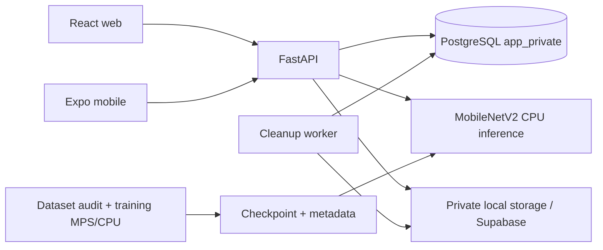

# Arsitektur WasteWise

## Komponen

Backend adalah satu aplikasi; tidak ada microservice atau queue eksternal. Inferensi dilindungi mutex dan dijalankan di threadpool; API tidak membuat classifier acak. Web melakukan code splitting per halaman dan TanStack Query untuk state server. Mobile memakai Expo Router dan refresh saat screen difokuskan.

## Alur laporan

Token diverifikasi lalu akun/role dibaca dari DB. Multipart dibatasi 6 MiB untuk keseluruhan request dan foto 5 MiB; isi JPEG/PNG/WebP didekode, orientasi EXIF diterapkan, metadata dihapus, RGB JPEG maksimal sisi 2048 disimpan. Inferensi memakai bytes hasil sanitasi yang sama. Kategori pengguna dan metadata AI disimpan terpisah. Status awal Pending dan user_id selalu berasal dari server.

Foto menggunakan key acak UUID di bawah folder pemilik. Respons menerbitkan signed URL 900 detik setelah otorisasi. Tidak ada direktori gambar publik. Local storage hanya untuk development/test; production diwajibkan memakai adapter Supabase privat. API service key hanya di backend.

## Konsistensi dan kegagalan

Penghapusan row laporan/akun dan pembuatan job cleanup terjadi dalam transaksi yang sama. Worker memakai SKIP LOCKED, lease 60 detik dan exponential backoff maksimal satu jam. Delete object idempoten; job selesai tetap disimpan untuk audit. Jika commit laporan gagal sesudah upload, server mencoba kompensasi; jika storage delete gagal, job dicatat. Gangguan DB yang juga menghalangi pencatatan kompensasi memerlukan rekonsiliasi orphan sebelum produksi.

Readiness memeriksa DB dan storage. Model hilang menghasilkan status degraded dengan HTTP 200, sehingga alur manual tetap hidup; `/predict` tetap 503. Dependency DB/storage gagal menjadikan readiness 503.

Rate limiting saat ini dalam memori per proses, dilindungi lock: login 10/IP/menit, register 5/IP/menit, predict dan create report 30/pengguna/menit. Jalankan satu worker API. Sebelum scale multi-worker, gunakan shared limiter atau gateway tepercaya dan konfigurasi proxy IP secara eksplisit.

## Batas produk

Admin dan user saja. Tidak ada pembayaran, reward, estimasi CO2, optimasi rute kendaraan, notifikasi eksternal, SSO. Supabase Auth menyediakan refresh otomatis, konfirmasi email dan pemulihan password web melalui PKCE. Web privat memakai noindex. Sesi Supabase native memakai SecureStore; web memakai penyimpanan SDK di browser. Mode Auth lokal untuk tes tetap memakai JWT tanpa refresh. Permintaan yang gagal tidak dimasukkan ke antrean offline; pengguna mendapat error dan dapat mencoba kembali.
