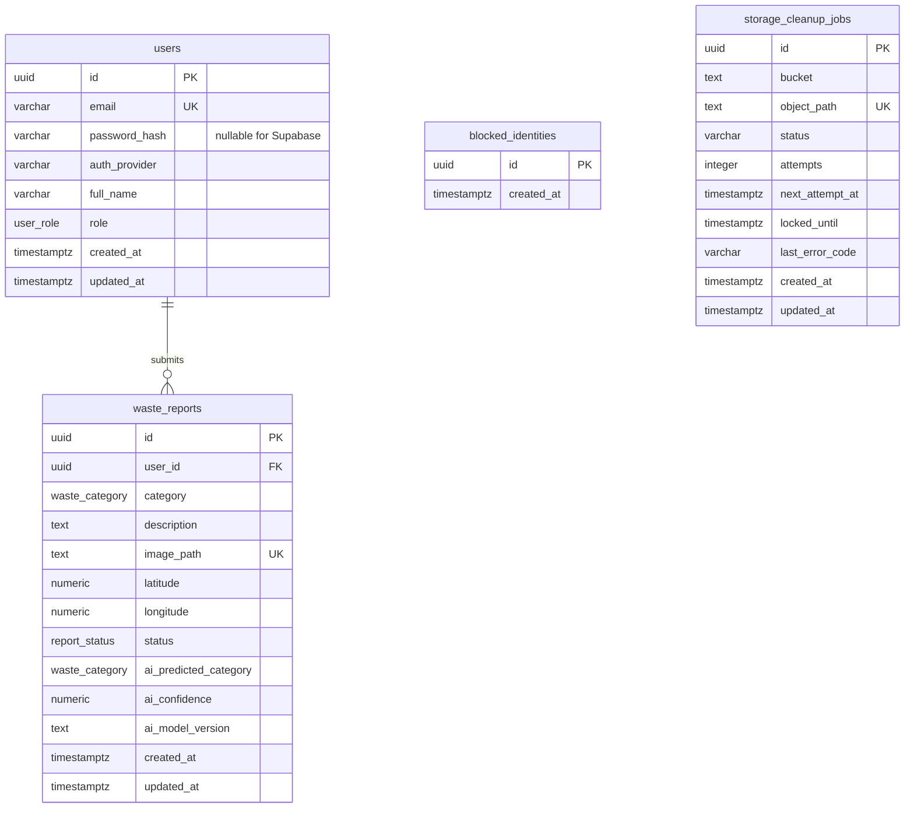

# Database schema dan ERD

Schema PostgreSQL: `app_private`. Migrasi executable: `backend-ml/migrations/versions/`; revisi akhir `41ba8d170ab2`. Upgrade telah dijalankan pada PostgreSQL 17 lokal. Runtime role memperoleh USAGE dan DML, bukan kepemilikan schema. `public.alembic_version` mencatat revisi.



## Enum dan constraints

- user_role: admin, user.
- waste_category: battery, biological, brown-glass, cardboard, clothes, green-glass, metal, paper, plastic, shoes, trash, white-glass.
- report_status: Pending, In Progress, Completed, Rejected.
- Email unik dan lowercase/trim. Nama 3..255 karakter setelah trim. Mode lokal: password bcrypt cost12. Mode Supabase: password_hash wajib NULL, auth_provider=supabase; ID sama dengan subject provider. Constraint menjaga pasangan provider/credential. blocked_identities menyimpan ID yang dinonaktifkan tanpa FK ke profil yang sudah dihapus.
- Report user_id FK dengan ON DELETE CASCADE. Deskripsi trim 10..5000, latitude -90..90, longitude -180..180. Numeric koordinat berpresisi 8 digit desimal.
- AI category/confidence/version harus semuanya NULL atau semuanya terisi. Confidence 0..100.
- image_path unik, tidak menyimpan permanent public URL.
- Cleanup unik pada pasangan bucket/object_path; attempts >=0; status pending/processing/completed. Tidak ada FK ke laporan yang dihapus.
- ID dan timestamp dikelola ORM; raw SQL yang menambah row harus memasok nilai wajib. Timestamp UTC bertipe timestamptz; updated_at dikelola ORM pada update aplikasi.

## Index dan transaksi

Laporan: `(user_id, created_at, id)`, `(status, created_at)`, `(category, created_at)`. Urutan pagination dibuat stabil dengan created_at DESC, id DESC. Join pemilik eager untuk menghindari N+1. Search deskripsi menggunakan ILIKE escaped; perlu index trigram jika data besar dan EXPLAIN membuktikan kebutuhan.

Cleanup: `(status, next_attempt_at)` dan `FOR UPDATE SKIP LOCKED`. Advisory lock `81744320` menserialisasi seluruh perubahan keanggotaan admin; hitung jumlah admin di dalam transaksi sebelum demote/delete. Tes dua demotion bersamaan memastikan hanya satu yang berhasil.

## Migrasi dan backup

```bash
cd backend-ml
DATABASE_URL='<owner PostgreSQL URL>' .venv/bin/alembic upgrade head
.venv/bin/alembic current
```

Jalankan migrasi dengan role pemilik terpisah dari runtime. Jangan mengekspos `app_private` melalui Supabase Data API. File `docs/schema.sql` adalah ekspor schema hasil migrasi untuk dibaca; sumber perubahan tetap Alembic. Downgrade menghapus tabel/enum dan hanya boleh dijalankan dengan persetujuan eksplisit pada lingkungan yang sesuai.

Backup: `pg_dump --format=custom` dengan kredensial dari secret manager; simpan terenkripsi di luar repo. Restore ke database staging kosong, bandingkan count dan constraints, periksa signed URL/storage objects. Backup/restore remote belum diuji; dump schema lokal bukan backup data pengguna.
