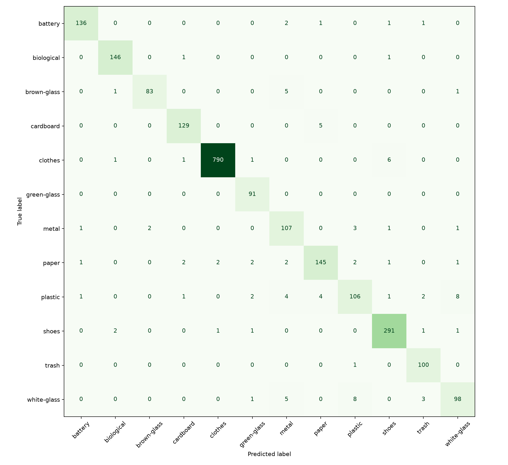
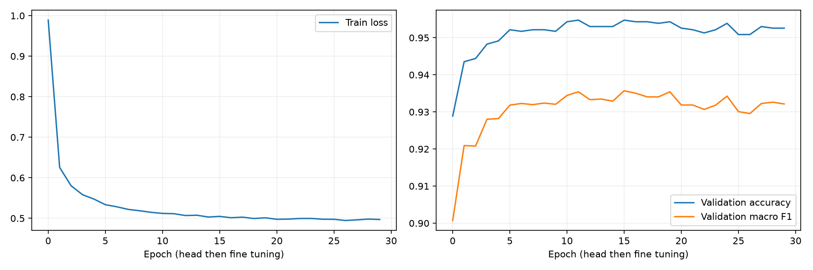

# Hasil evaluasi model WasteWise v1

Evaluasi nyata pada test split beku **2318 gambar**, device `mps`. Checkpoint dipilih hanya dari validation macro F1. Tidak ada tuning setelah test dibuka.

- Accuracy: **0.958585 (95.86%)**.
- Macro F1: **0.940986**.
- Weighted F1: **0.958411**.
- F1 minimum: **0.851406**.
- Gate accuracy >0,85: **LULUS**. Gate seluruh F1 kelas >=0,75: **LULUS**.
- Waktu evaluasi batch: 34.42 detik, termasuk pembacaan dan preprocessing; bukan benchmark latency API.

| Kelas | Precision | Recall | F1 | Support |
| --- | --- | --- | --- | --- |
| battery | 0.9784 | 0.9645 | 0.9714 | 141 |
| biological | 0.9733 | 0.9865 | 0.9799 | 148 |
| brown-glass | 0.9765 | 0.9222 | 0.9486 | 90 |
| cardboard | 0.9627 | 0.9627 | 0.9627 | 134 |
| clothes | 0.9962 | 0.9887 | 0.9925 | 799 |
| green-glass | 0.9286 | 1.0000 | 0.9630 | 91 |
| metal | 0.8560 | 0.9304 | 0.8917 | 115 |
| paper | 0.9355 | 0.9177 | 0.9265 | 158 |
| plastic | 0.8833 | 0.8217 | 0.8514 | 129 |
| shoes | 0.9636 | 0.9798 | 0.9716 | 297 |
| trash | 0.9346 | 0.9901 | 0.9615 | 101 |
| white-glass | 0.8909 | 0.8522 | 0.8711 | 115 |

## Bukti

- [metrics.json](../backend-ml/outputs/evaluation/metrics.json): laporan mesin dan matrix12x12.
- [predictions.jsonl](../backend-ml/outputs/evaluation/predictions.jsonl): path, actual, predicted dan probabilitas setiap gambar.
- [Confusion matrix](../backend-ml/outputs/evaluation/confusion_matrix.png): baris label benar, kolom prediksi.
- [Kurva training](../backend-ml/outputs/evaluation/training_curves.png): train loss, validation accuracy/macro F1, bukan test per epoch.
- [Training history](../backend-ml/ml/models/training_history.json).

Checkpoint SHA256: `dbc357905538c29e82f40119b58d73c4e69405a07a10840543ebda1aee09a88d`.

Test manifest SHA256: `b2042dc8c146c703d679f47d370787e59de3d65018d3e5950ceef8cb6b864aa7`.

## Interpretasi

Hasil berlaku pada distribusi dataset lokal setelah grouping dan exclusion. Angka test tidak membuktikan performa kamera rumah tangga, segmentasi multi-objek, kalibrasi confidence, atau keselamatan penanganan B3. pHash grouping mengurangi duplikat silang split namun tidak menjamin seluruh sumber pengambilan independen. Belum ada external holdout, interval kepercayaan yang dihitung, kalibrasi atau uji lapangan. Kumpulkan holdout lapangan baru dengan hak data yang jelas untuk pengujian berikutnya; jangan menyetel model terhadap test ini.
