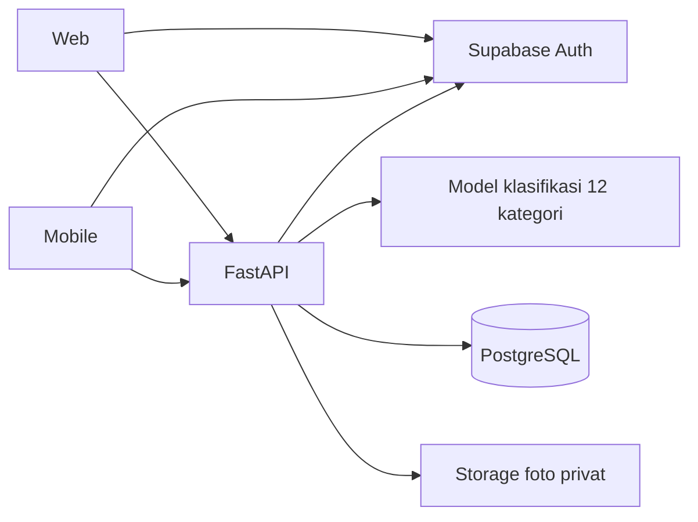

> Audit historis sebelum perubahan workflow otomatis. Status terkini: [WORKFLOW_IMPLEMENTATION.md](WORKFLOW_IMPLEMENTATION.md). Temuan kontrak manual/CRUD/dashboard pada baseline telah diperbaiki; gate perangkat/rilis tetap harus diverifikasi.

# Audit checklist website, mobile, dan Machine Learning

Tanggal: 2 November 2026. Acuan: checklist A/B/C yang dikirim pengguna dalam percakapan. Pemeriksaan source aplikasi pada commit `ec058f8` beserta working tree saat audit; perubahan konfigurasi jaringan lokal dan dokumen tetap dipertahankan. Tidak ada implementasi fitur atau training ulang pada audit ini.

**Putusan: sebagian besar sesuai, tetapi belum seluruhnya. Kekurangan implementasi utama adalah edit isi laporan; CRUD laporan belum lengkap. Verifikasi native iPhone dan pengiriman email tetap terbuka. Semua persyaratan ML dalam checklist terpenuhi pada lingkup klasifikasi gambar.**

Status **Sesuai** berarti implementasi dan bukti yang relevan ditemukan pada lingkup API/browser/dataset. Status ini tidak berarti deployment produksi atau seluruh perangkat sudah diuji. **Tersedia, perlu uji perangkat** berarti source fitur ada, tetapi pembuktian hardware/iPhone belum lengkap. **Sebagian** berarti ada fungsi yang diminta dan belum diimplementasikan.

## A. Website Development

| Persyaratan | Status | Bukti dan cakupan |
| --- | --- | --- |
| Login dan autentikasi Admin/User | Sesuai | SDK Supabase, verifikasi token provider dan pengecekan role server. `backend-ml/app/security.py:70`, `backend-ml/app/security.py:103`, `web/src/Auth.tsx`. Smoke Supabase membuktikan login, role metadata diabaikan, dan perubahan role DB berlaku. |
| Dashboard statistik laporan sampah | Sesuai | Total, distribusi kategori/status dan laporan terbaru dari server. User hanya miliknya; admin seluruh laporan. `web/src/pages/Dashboard.tsx:22`, `backend-ml/app/reports.py:202`. |
| Manajemen laporan CRUD | **Sebagian** | Create: POST `/reports`; Read: GET list/detail; Delete: DELETE detail. API aktif hanya menyediakan GET/DELETE pada `/reports/{report_id}` dan PATCH pada subpath `/status`. Tidak tersedia PUT/PATCH untuk mengubah deskripsi, kategori, lokasi atau foto laporan. UI web juga hanya mengubah status. `backend-ml/app/reports.py:119`, `:176`, `:181`, `:191`; `web/src/pages/ReportDetail.tsx:36`. |
| Filter dan pencarian laporan | Sesuai | Pencarian deskripsi, filter kategori/status, pagination server. Filter tidak menghilangkan batas kepemilikan. `backend-ml/app/reports.py:78`, `web/src/pages/Reports.tsx`. |
| Manajemen pengguna | Sesuai | Daftar/pagination, perubahan role, hapus akun; API juga mendukung perubahan nama. Admin terakhir dan hapus diri sendiri dilindungi. UI tidak menyediakan editor nama. `backend-ml/app/auth.py:93`, `:153`, `:174`; `web/src/pages/Users.tsx`. |
| Update Pending/In Progress/Completed/Rejected | Sesuai | Enum memuat keempat nilai tepat, endpoint dibatasi admin, UI menampilkan label Indonesia. `backend-ml/app/schemas.py:22`, `backend-ml/app/reports.py:181`. |
| Responsive design | Sesuai pada ukuran diuji | CSS media queries dan drawer mobile; bukti browser 390/1440 px serta pemeriksaan overflow. `web/src/styles.css`, `docs/evidence/audit-cloud-browser.json`, `docs/DESIGN_QA.md`. Tidak mengklaim seluruh ukuran/font sudah diperiksa. |

### Temuan utama: CRUD belum lengkap

Mengganti status adalah operasi update yang sempit. Karena checklist menuliskan CRUD dan update status sebagai dua persyaratan terpisah, audit ini memperlakukan CRUD penuh sebagai kemampuan mengedit isi laporan juga. Pemilik belum dapat memperbaiki salah deskripsi, kategori atau koordinat setelah laporan tersimpan. Tombol mobile `Perbarui foto dan detail` hanya mengambil ulang data/signed URL; tombol tersebut bukan editor laporan.

Perbaikan yang diperlukan: endpoint edit laporan dengan validasi dan otorisasi pemilik/admin, formulir edit web, serta pengujian perubahan tersimpan dan penolakan lintas pemilik. Penggantian foto, bila diizinkan, harus menjaga metadata prediksi server serta mengantrekan cleanup foto lama. CRUD baru dianggap penuh setelah alur edit tersebut berjalan; fitur ini belum ditambahkan dalam audit.

## B. Mobile Application

| Persyaratan | Status implementasi | Bukti/verifikasi |
| --- | --- | --- |
| Register dan login | Tersedia; perlu uji iPhone/email | SDK `signUp`/`signInWithPassword`, konfirmasi dan sesi SecureStore native. `mobile/src/session.tsx:126`, `:144`, `mobile/src/supabase.ts`. Login/reload/logout dengan Supabase nyata lulus di Expo web. Pengiriman email nyata dan keberhasilan login ulang pada iPhone pengguna belum dikonfirmasi. |
| Dashboard pengguna | Tersedia; teruji Expo web | Ringkasan dari `/api/v1/stats/summary`, mengikuti role/kepemilikan server. `mobile/app/(tabs)/index.tsx:16`. |
| Laporan berfoto, GPS, deskripsi | Tersedia; kamera/GPS perlu uji perangkat | Kamera/galeri memakai expo-image-picker; GPS meminta foreground permission lalu `getCurrentPositionAsync`; deskripsi dan koordinat divalidasi sebelum multipart dikirim. `mobile/src/photo.ts:4`, `mobile/app/new-report.tsx:38`, `:53`. Galeri/upload/deskripsi/koordinat manual diuji di Expo web; ini bukan bukti GPS atau kamera iPhone. |
| Riwayat dan status laporan | Tersedia; teruji Expo web | List/detail, pencarian, filter status dan pagination. `mobile/app/(tabs)/reports.tsx:27`, `mobile/app/report/[id].tsx`. |
| API untuk kirim/ambil data | Tersedia; teruji API/Expo web | Fetch Bearer token, FormData upload, GET laporan/statistik dan DELETE. `mobile/src/api.ts`, `mobile/app/new-report.tsx:79`. URL LAN telah diperbaiki untuk bundle iOS; koneksi dari iPhone masih memerlukan pembuktian pengguna. |
| AI Image Detection | Sesuai untuk klasifikasi gambar | Foto dikirim ke POST `/api/v1/predict`; hasil kategori/confidence/panduan dapat diteruskan menjadi draft laporan. `mobile/app/(tabs)/classify.tsx:43`. Inferensi model nyata lulus di Expo web. Model menghasilkan satu label kategori per foto; tidak menghasilkan bounding box atau mendeteksi beberapa objek terpisah. |

Pengguna telah memperlihatkan aplikasi terbuka dalam Expo Go pada iPhone. Itu membuktikan aplikasi dapat dimuat, tetapi screenshot kegagalan jaringan tidak membuktikan login/kamera/GPS berhasil. Diagnosis LAN sebelumnya: mobile belum memiliki `.env`, fallback localhost, API bind loopback. Konfigurasi sudah diperbaiki; GET health/auth config melalui LAN HTTP200 dan bundle iOS memuat URL LAN. Tidak menyatakan pengujian native selesai sebelum pengguna mengonfirmasi alur pada HP.

## C. Machine Learning

| Persyaratan | Status | Bukti aktual |
| --- | --- | --- |
| Model klasifikasi sampah | Sesuai | MobileNetV2 dengan classifier 12 kelas, checkpoint nyata `backend-ml/ml/models/wastewise-v1.pth`; checksum cocok metadata. |
| Minimal Organic/Plastic/Paper | Sesuai | 12 kelas mencakup `biological` = Organik/Organic Waste, `plastic` = Plastik, `paper` = Kertas. Mapping di `shared/categories.json:3`, `:9`, `:10`. Nama ID dataset tetap dipertahankan. |
| Dataset minimal 150 gambar | Sesuai | Hitungan file lokal 15.515 JPG, 12 kategori. Setelah exclusion/group split: train10.793, validation2.320, test2.318. Sumber Kaggle Mostafa Abla, bukan data rekaan. `backend-ml/dataset/audit.json`, `docs/DATASET.md`. |
| Python + TensorFlow/Keras atau PyTorch | Sesuai | Python, PyTorch, torchvision. `backend-ml/ml/common.py:6`, `backend-ml/ml/train.py`. Tidak memerlukan kedua framework sekaligus. |
| Training dan testing | Sesuai | Training history, metadata, checkpoint, split tetap dan prediksi test tersimpan. Checkpoint dipilih memakai validation macro F1. Training/evaluasi dilakukan sebelumnya; tidak diulang atau di-tuning dalam audit ini. |
| Accuracy, confusion matrix, classification report | Sesuai | `backend-ml/outputs/evaluation/metrics.json`, `confusion_matrix.png`, `predictions.jsonl`, `docs/EVALUATION.md`. Perhitungan ulang dari2.318prediksi tersimpan menghasilkan classification report dan confusion matrix identik dengan artefak. |
| Accuracy minimal80% pada testing | Sesuai | **95,86%** pada2.318gambar test; macro F1 **94,10%**; F1 kelas terendah **85,14%**. Ini hasil dataset test, belum hasil holdout kamera lapangan. |
| REST API prediksi | Sesuai | FastAPI POST `/api/v1/predict`, upload foto, response kategori/confidence/probabilitas/model version. Autentikasi diwajibkan. `backend-ml/app/reports.py:227`. Checkpoint hilang tidak menghasilkan prediksi palsu; API mengembalikan503. |

Sumber dataset: https://www.kaggle.com/datasets/mostafaabla/garbage-classification. Dataset lokal dan arsip tidak termasuk clone GitHub; lisensi gambar mengikuti pemilik aslinya sesuai THIRD_PARTY_NOTICES.

## WasteWise itu aplikasi apa?

WasteWise adalah aplikasi pelaporan dan pemilahan sampah berbantuan klasifikasi gambar. Pengguna mengunggah foto, melihat perkiraan material dan panduan, lalu membuat laporan berisi kategori final, deskripsi, dan lokasi. Pengelola memantau laporan serta memperbarui status penanganan. Status dicatat oleh manusia; aplikasi ini tidak membuktikan sampah sudah diangkut atau diproses hanya berdasarkan hasil AI.

Web dan mobile adalah dua antarmuka untuk sistem yang sama. Keduanya dapat dipakai user; pengelolaan pengguna tersedia di web admin. Dengan akun yang sama, data laporan yang sama dapat diakses dari web dan mobile sesuai hak akses. ML berjalan pada backend, bukan melatih ulang model di setiap ponsel.

| Bagian | Tanggung jawab | Hubungan |
| --- | --- | --- |
| Web React | Dashboard, klasifikasi, laporan, filter, manajemen pengguna/status | Memanggil API yang sama dengan mobile |
| Mobile Expo | Foto kamera/galeri, GPS, klasifikasi, laporan dan riwayat | Memanggil API melalui jaringan |
| FastAPI | Validasi input, hak akses, transaksi laporan, pemanggilan model | Menjadi penghubung kedua UI, database, foto dan ML |
| Supabase Auth | Identitas, login, konfirmasi dan sesi | Token diverifikasi API; role aplikasi tetap dibaca dari database |
| Supabase PostgreSQL/Storage | Data laporan/profil dan foto privat | API memberi data sesuai pemilik/admin dan signed URL foto |
| Model ML | Memperkirakan kategori dan confidence dari foto | Dilatih memakai `garbage_classification`; checkpoint dipakai API untuk inferensi |

Contoh alur: user memilih foto botol di mobile; API meminta model memperkirakan kategori; user memeriksa hasil lalu menyimpan foto, kategori final, lokasi dan deskripsi. Admin melihat laporan tersebut pada web, lalu mengubah status. Saat riwayat mobile dimuat ulang, status baru diambil dari database yang sama. Nilai prediksi membantu kategori; keputusan status tetap pada admin.

## Pemeriksaan pada audit ini

- Membaca implementasi endpoint dan UI, termasuk tidak adanya endpoint/form edit isi laporan. OpenAPI API aktif mengonfirmasi GET/POST list, GET/DELETE detail, PATCH status dan POST predict.
- `npm run check` lulus: TypeScript/ESLint web dan TypeScript mobile.
- Health melalui loopback/LAN HTTP200: database, storage dan model ready.
- Menghitung ulang15.515file JPG dan12kategori; checksum checkpoint sesuai metadata.
- Menghitung ulang accuracy, classification report dan confusion matrix dari2.318prediksi test tersimpan; seluruhnya sesuai artefak evaluasi. Tidak menyebut ini sebagai inferensi ulang seluruh test.
- Bukti runtime sebelumnya tetap dirujuk:19tes backend,4tes kontrak Auth, smoke Supabase nyata dan browser web/Expo web. Seluruh suite tersebut tidak diulang dalam audit checklist ini karena implementasi fungsional tidak diubah. Bukti: `docs/evidence/supabase-smoke.json`, `audit-cloud-browser.json`, `audit-summary.json` dan `TESTING.md`.

**Prioritas berikutnya: lengkapi edit isi laporan untuk menutup kekurangan CRUD, kemudian buktikan login, kamera dan GPS langsung pada iPhone.**
