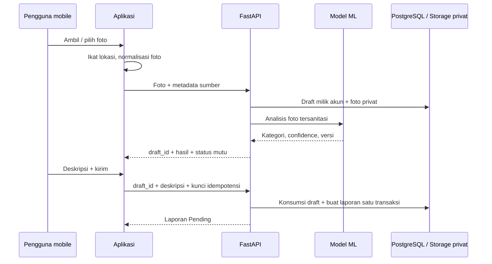

# Rencana perbaikan sistem dan logika WasteWise

Tanggal: 2 November 2026.

**Status: implementasi sistem tersedia; verifikasi perangkat fisik dan deployment publik masih terbuka.** Kontrak draft/finalisasi, kamera/galeri, GPS otomatis, dashboard, review, edit, riwayat, thumbnail dan migrasi Supabase sudah diimplementasikan. Dokumen ini mempertahankan rancangan awal; tabel baseline menjelaskan keadaan sebelum perubahan. Hasil pengujian terbaru berada di [WORKFLOW_IMPLEMENTATION.md](WORKFLOW_IMPLEMENTATION.md), bukan klaim bahwa seluruh gate perangkat/performa telah terpenuhi.

## 1. Keputusan produk dan batas pekerjaan

1. **Mobile menjadi pintu utama pelaporan.** Kamera adalah tindakan utama; galeri menjadi alternatif. Pengambilan/pemilihan foto langsung memicu klasifikasi, tanpa tombol klasifikasi tambahan.
2. **Kategori berasal dari model server.** Pengguna tidak memilih kategori atau mengirim nilai confidence. Hasil kategori ditampilkan sebagai informasi yang tidak bisa diedit pengguna.
3. **Koordinat diperoleh otomatis.** Form latitude/longitude manual dihapus dari alur pengguna. Lokasi tidak dilacak terus-menerus di latar belakang.
4. **Keputusan galeri telah dikonfirmasi pengguna:** jika GPS foto tidak tersedia, GPS HP saat unggah boleh digunakan setelah pengguna menyatakan foto berasal dari lokasi tersebut. Data tetap diberi sumber `device_upload_confirmed`, bukan diklaim sebagai GPS saat pemotretan.
5. **Web admin berfokus pada penanganan laporan.** Dashboard pengguna dan admin memiliki isi/tindakan berbeda. Akses pengguna web tetap tersedia, menggunakan aturan kategori/lokasi otomatis yang sama.
6. **Model 12 kelas dan stack yang sudah bekerja dipertahankan.** Tidak mengganti React/Vite, Expo, FastAPI, PostgreSQL/Supabase, atau melatih ulang model tanpa hasil pengukuran yang membutuhkannya.
7. **Penyempurnaan visual menyusul logika.** Identitas dalam DESIGN.md dipertahankan. Tahap ini menetapkan susunan informasi dan perilaku; tidak membuat aset atau mengganti branding.

Target pengguna: warga yang melapor melalui HP dan admin yang meninjau antrean. Keberhasilan utama: satu foto menghasilkan satu laporan dengan hasil AI dan sumber lokasi yang dapat ditelusuri; admin dapat menindaklanjutinya tanpa menghitung data secara manual.

## 2. Dasar rencana dari implementasi sekarang

| Area | Kondisi aktual | Konsekuensi |
| --- | --- | --- |
| Mobile klasifikasi | `mobile/app/(tabs)/classify.tsx` meminta tombol klasifikasi setelah foto dipilih; hasil diteruskan sebagai kategori draft | Foto belum langsung diproses dalam satu alur pelaporan |
| Mobile laporan | `mobile/app/new-report.tsx` menyediakan pilihan kategori, input koordinat, dan tombol lokasi terpisah | Kategori/GPS belum otomatis sesuai arahan baru |
| Metadata foto | `mobile/src/photo.ts` hanya menyimpan URI, nama, MIME; opsi EXIF tidak diaktifkan | Sumber foto, waktu pengambilan, dan GPS foto tidak diteruskan |
| Backend laporan | `backend-ml/app/reports.py` menerima kategori client; saat ML gagal, laporan manual tetap disimpan | Aturan kategori otomatis harus ditegakkan pada API juga |
| Pengulangan proses | Prediksi dilakukan pada `/predict`, kemudian dilakukan lagi saat `/reports` menerima foto yang sama | Upload dan inferensi berulang dalam alur klasifikasi menjadi laporan |
| Dashboard | `web/src/pages/Dashboard.tsx` memiliki tiga ringkasan, lima laporan terbaru, distribusi kategori/status, serta ajakan klasifikasi | Informasi admin belum berorientasi antrean dan periode |
| Waktu penanganan | Laporan hanya memiliki `created_at`/`updated_at`; belum ada riwayat status | `updated_at` tidak dapat dianggap sebagai waktu selesai atau respons pertama |
| Performa | Route web sudah lazy-loaded, list memakai pagination, mobile riwayat sudah FlatList | Pertahankan fondasi ini; cari hambatan dengan profil, bukan menulis ulang semuanya |
| Jaringan HP | API lokal sudah diarahkan melalui LAN, keberhasilan native belum lengkap | Pengujian perangkat dan URL API HTTPS tetap menjadi syarat rilis |
| Model | Model klasifikasi 12 kelas sudah tersedia dan dievaluasi | Fokus awal pada integrasi, penanganan ketidakpastian, dan foto lapangan |

Audit fitur lengkap: [REQUIREMENTS_AUDIT.md](REQUIREMENTS_AUDIT.md). Bukti pengujian sebelumnya: [evidence/audit-summary.json](evidence/audit-summary.json). Bukti tersebut bukan hasil pengujian perubahan yang masih direncanakan.

## 3. Prioritas pertama: foto, ML, GPS, laporan menjadi satu alur

### 3.1 Alur kamera

1. Pengguna memilih **Ambil foto sampah**. Izin kamera dan lokasi foreground diminta saat fitur digunakan, dengan penjelasan singkat.
2. Kamera di dalam aplikasi menampilkan panduan satu objek dominan, cahaya cukup, dan lokasi yang sedang diperoleh. Implementasi memakai modul kamera yang kompatibel dengan Expo SDK terpasang; versi diverifikasi sebelum menambah dependensi.
3. Saat shutter ditekan, aplikasi mencatat waktu pengambilan dan mengikatnya ke fix GPS yang masih baru. GPS tidak diminta baru setelah pengguna berpindah tempat atau menekan kirim beberapa menit kemudian.
4. Foto dinormalisasi orientasinya, dikonversi ke JPEG bila perlu, dan diperkecil sebelum upload. Metadata lokasi yang diperlukan diekstrak terlebih dahulu; EXIF lengkap tidak disimpan bersama gambar publik/privat hasil sanitasi.
5. Foto dikirim satu kali. Backend memvalidasi foto, menyimpan draft privat, dan menjalankan model yang sudah ada.
6. Hasil kategori, confidence, panduan, preview foto, dan sumber lokasi tampil otomatis. Pengguna menambahkan deskripsi, lalu mengirim laporan.
7. Backend membuat laporan `Pending` dari draft milik pengguna. Setelah sukses, aplikasi membuka detail/riwayat; dashboard admin mengambil data yang sama.

Modul awal yang dipertimbangkan: `expo-camera` untuk shutter dalam aplikasi, `expo-location` yang sudah ada untuk GPS, `expo-image-picker` untuk galeri, serta `expo-image-manipulator` untuk normalisasi/kompresi. Penyimpanan draft lintas restart memakai direktori privat aplikasi melalui modul filesystem yang kompatibel. Instalasi memakai mekanisme Expo, bukan menebak nomor versi atau mengganti seluruh sistem kamera.

GPS hanya aktif selama alur pengambilan/lokasi memerlukannya. Watcher dihentikan saat layar ditinggalkan, aplikasi masuk background, pengguna membatalkan, atau fix sudah dipakai. Waktu/fix lama tidak boleh ditempelkan ke foto baru.

### 3.2 Alur galeri dan ketepatan asal lokasi

| Kondisi foto | Perilaku |
| --- | --- |
| Memiliki EXIF GPS yang valid | Lokasi foto dipakai otomatis; sumber ditampilkan sebagai metadata foto. Timestamp hanya dicatat jika tersedia dan dapat ditafsirkan |
| Tidak memiliki EXIF GPS | Aplikasi meminta GPS saat ini dan konfirmasi: **Foto ini diambil di lokasi saya saat ini** |
| Pengguna menyetujui konfirmasi | Simpan `device_upload_confirmed`, waktu fix GPS, dan waktu unggah. Waktu pengambilan foto tetap tidak diketahui bila tidak tersedia |
| Pengguna tidak menyetujui | Foto tetap bisa diklasifikasikan; pengiriman laporan berbasis lokasi menunggu foto ulang di tempat atau foto dengan metadata yang sesuai |
| Izin lokasi ditolak/GPS mati | Tampilkan cara mengaktifkan izin dan coba lagi. Klasifikasi boleh berjalan; laporan belum dikirim tanpa lokasi yang memenuhi syarat |

Konfirmasi terikat pada foto dan fix lokasi tertentu. Mengganti foto atau mengambil ulang lokasi membatalkan konfirmasi sebelumnya. Tidak ada checkbox yang otomatis tercentang.

**Batas kepercayaan:** EXIF bisa diubah; koordinat perangkat juga bisa dipalsukan. Validasi server dapat memeriksa bentuk, rentang, waktu, serta konsistensi data, tetapi tidak membuktikan keberadaan fisik pengguna. Sumber ini ditampilkan sebagai informasi asal data, bukan sertifikat lokasi terverifikasi. Tidak menambahkan reverse geocoding sebagai syarat kirim; alamat manusia dapat menyusul tanpa menghalangi laporan.

### 3.3 Aturan mutu lokasi

- Simpan `location_source`, `location_recorded_at`, `location_accuracy_m` jika diketahui, `photo_source`, dan `captured_at` jika diketahui. Timestamp server menjadi `received_at` terpisah.
- Usulan awal untuk GPS perangkat: umur fix maksimal 30 detik saat shutter/konfirmasi, akurasi horizontal maksimal 50 meter, timeout permintaan 20 detik. Nilai ini merupakan parameter awal yang harus diuji di lapangan.
- Jika akurasi tidak cukup, tampilkan kondisi dan tombol coba lokasi lagi; jangan mengisi `0,0`, memakai last-known fix tanpa batas usia, atau menyuruh pengguna mengetik koordinat.
- EXIF biasanya tidak memiliki accuracy radius. Simpan `null` dengan sumber metadata, bukan angka akurasi rekaan. Timestamp EXIF tanpa informasi zona waktu tidak diubah menjadi UTC dengan asumsi diam-diam.
- Lokasi kamera dipasangkan terhadap waktu shutter. Setelah app resume/background atau foto diganti, lakukan pemeriksaan ulang; jangan mengklaim lokasi baru sebagai lokasi foto lama.

### 3.4 Kategori otomatis dan batas model

- Hanya backend yang menetapkan `ai_predicted_category`, `ai_confidence`, `ai_model_version`, dan kategori awal laporan.
- Tidak ada dropdown kategori atau fallback laporan manual untuk pengguna, termasuk melalui API atau web alternatif.
- Foto pengganti selalu menghasilkan analisis baru. Deskripsi tidak dapat mengubah hasil ML.
- Prediksi kurang meyakinkan diberi `classification_state=needs_review`. Pengguna dapat mengambil foto ulang atau mengirim hasil sementara ke antrean review admin; pengguna tidak memilih label penggantinya.
- Prediksi yang memenuhi kebijakan mutu diberi `classification_state=classified`. Ini berarti lolos aturan model, bukan jaminan benar di dunia nyata.
- Threshold confidence dan selisih dua kelas teratas ditetapkan memakai data validation; tidak dipilih dari test split atau sekadar disamakan dengan target accuracy 80%.
- Confidence bukan persentase ketepatan aplikasi. Model 12 kelas selalu mencoba memilih salah satu kelas dan bisa sangat yakin pada foto bukan sampah. Ambang confidence saja tidak cukup untuk menjamin penolakan gambar di luar kategori.
- Tambahkan sampel uji lapangan terpisah: objek tunggal, latar ramai, objek kecil, cahaya buruk, beberapa jenis sampah, blur, serta gambar bukan sampah. Hasilnya menentukan kebutuhan pengambilan ulang, review, atau pengembangan model berikutnya.
- Saat model gagal/tidak tersedia, simpan draft untuk retry dan tampilkan masalah. Jangan membuat laporan seolah kategorinya sudah dihasilkan ML.
- Admin dapat mengoreksi kategori melalui tindakan review beralasan; hasil ML asli tetap tersimpan. Koreksi bukan label yang diisikan pengguna atau perubahan diam-diam pada hasil prediksi.

`classification_state` terpisah dari status penanganan `Pending`, `In Progress`, `Completed`, `Rejected`. Foto yang perlu review belum tentu laporan yang ditolak.

### 3.5 Satu upload, satu analisis, finalisasi yang aman

Usulan: gunakan draft server yang mengikat foto dan hasil prediksi sebelum laporan difinalisasi. Ini menghindari upload/prediksi dua kali sekaligus mencegah client menyuntikkan hasil ML.

| Kontrak yang diusulkan | Tanggung jawab |
| --- | --- |
| `POST /api/v1/report-drafts` | Multipart foto dan metadata; validasi, sanitasi, foto privat, prediksi, draft berumur terbatas |
| `GET /api/v1/report-drafts/{id}` | Memulihkan draft/result milik akun setelah retry atau aplikasi dibuka ulang |
| `PATCH /api/v1/report-drafts/{id}` | Memperbarui bukti lokasi/konfirmasi yang belum lengkap; tidak menerima kategori/confidence |
| `DELETE /api/v1/report-drafts/{id}` | Membatalkan draft dan mengantrekan cleanup yang aman |
| `POST /api/v1/reports` | JSON `draft_id`, `description`; hasil ML dan foto diambil dari draft server, bukan upload ulang |
| `PATCH /api/v1/reports/{id}` | Melengkapi CRUD: edit deskripsi, atau memakai draft pengganti yang telah diproses untuk foto/lokasi; tidak menerima kategori/GPS bebas |
| `PATCH /api/v1/reports/{id}/review` | Admin mengonfirmasi/mengoreksi kategori dengan alasan dan riwayat; prediksi asli dipertahankan |

Detail teknis yang wajib:

- Kepemilikan diperiksa pada setiap akses draft/report. UUID yang diketahui bukan izin akses.
- Draf tidak bisa mengganti foto setelah analisis; penggantian foto membuat versi/draft baru. Respons request foto lama tidak boleh menimpa hasil foto terbaru.
- Simpan hash foto tersanitasi dan versi model bersama hasil; gunakan referensi server, bukan hash dari client sebagai bukti prediksi.
- `Idempotency-Key` untuk create/finalisasi mencegah duplikasi akibat double tap, timeout, atau retry. Key yang sama dengan payload sama mengembalikan hasil semula; payload berbeda ditolak `409`.
- Unique constraint konsumsi draft dan locking transaksi mencegah satu draft menjadi dua laporan pada request bersamaan. Cleanup dan finalisasi mengunci keadaan draft yang sama.
- Draft tidak terkonsumsi kedaluwarsa, usulan 24 jam. Hanya draft kedaluwarsa tanpa referensi laporan yang boleh masuk cleanup. Foto laporan aktif tetap dilindungi worker.
- Jika model gagal setelah upload, draft berstatus gagal/pending retry dapat dipulihkan. Foto tidak di-upload ulang untuk retry model; hasil gagal tidak boleh difinalisasi sebagai prediksi sukses.
- Kegagalan DB/Storage tidak boleh menghasilkan sukses palsu. Gunakan kompensasi/outbox cleanup yang sudah ada, termasuk thumbnail baru.
- Jangan menambahkan job queue terpisah sebelum profiling membuktikan inferensi sinkron dengan concurrency terbatas tidak mencukupi.

Kontrak `POST /reports` berubah dari multipart manual menjadi finalisasi draft. Karena rilis publik/native belum dibuktikan, rencanakan cutover backend, web, dan mobile secara terkoordinasi di staging. Jika ditemukan client publik yang sudah bergantung pada kontrak lama, versioning API diperlukan. Jangan membiarkan endpoint lama menjadi jalur permanen untuk laporan kategori manual setelah aturan baru berlaku.

### 3.6 Kelengkapan CRUD dan data lama

- Usulan izin: pemilik dapat mengedit laporan sendiri ketika `Pending`; admin mempunyai tindakan pengelolaan sesuai scope. Respons konflik dikembalikan jika status berubah selama edit.
- Edit deskripsi memakai endpoint update. Mengganti foto/lokasi melewati draft baru agar kategori dan sumber GPS tidak lepas dari foto.
- Kategori otomatis tidak berubah hanya karena deskripsi diedit. Koreksi kategori admin selalu beralasan dan dapat ditelusuri.
- Simpan versi/revision laporan; update dengan versi lama ditolak `409`, bukan menimpa pekerjaan admin/pengguna lain.
- Data lama tetap dibaca. Asal lokasi yang belum diketahui diberi `legacy_unknown`; jangan mengarang akurasi GPS, waktu shutter, riwayat status, atau memaksa hasil prediksi baru pada laporan lama.

## 4. Prioritas kedua: dashboard admin untuk pekerjaan nyata

### 4.1 Pertanyaan yang harus dijawab dashboard

1. Berapa laporan yang perlu ditangani sekarang?
2. Mana yang paling lama menunggu atau membutuhkan review klasifikasi?
3. Apa perubahan volume laporan pada periode yang dipilih?
4. Kategori sampah apa yang dominan dan bagaimana status penanganannya?
5. Siapa yang mengubah status/kategori, kapan, dan mengapa?

Ajakan klasifikasi dan panduan material dapat berada pada halaman pengguna atau menu tersendiri. Area utama admin dipakai untuk antrean kerja.

### 4.2 Susunan informasi yang diusulkan

| Urutan | Isi | Perilaku |
| --- | --- | --- |
| 1 | Judul operasional, periode, filter kategori/status, waktu pembaruan | Default cohort 30 hari; semua filter tersimpan di URL dan bisa di-reset |
| 2 | Ringkasan cohort: total, Pending, In Progress, Completed, Rejected, perlu review | Klik ringkasan membuka daftar dengan filter yang persis sesuai |
| 3 | Antrean seluruh laporan aktif: Pending tertua dan review klasifikasi | Dipisahkan dan dilabeli sebagai antrean saat ini; tidak hilang karena periode cohort sempit |
| 4 | Tren laporan masuk per hari dan distribusi 12 kategori | Angka nyata, sumbu tanggal jelas, angka/tabel alternatif; tanpa grafik dekoratif |
| 5 | Tabel kerja laporan | ID pendek, thumbnail, pelapor, kategori/flag review, sumber lokasi, tanggal/umur, status, tindakan |
| 6 | Detail laporan dan riwayat | Foto lebih besar, deskripsi, kategori AI/asli dan hasil review, lokasi, akurasi/waktu bila tersedia, perubahan status |

Desktop dapat menempatkan tren dan distribusi berdampingan. Pada layar kecil, ringkasan membungkus dan antrean tampil sebelum grafik. Tabel berubah menjadi kartu ringkas atau menyediakan scroll hanya pada wilayah tabel; halaman keseluruhan tidak boleh melebar.

Peta interaktif dan library grafik besar bukan kebutuhan awal. Mulai dengan lokasi tekstual/tautan peta pada detail dan grafik SVG/CSS yang kecil. Jika pemetaan banyak titik terbukti diperlukan, muat sebagai fitur terpisah yang lazy-loaded.

### 4.3 Definisi statistik agar angka tidak menyesatkan

| Metrik | Definisi |
| --- | --- |
| Total cohort | Laporan yang masih tersimpan dengan `created_at` pada `[from, to)` dan filter aktif |
| Jumlah per status cohort | Status terkini dari laporan dalam cohort yang sama; bukan jumlah transisi status dalam periode |
| Perlu review cohort | Laporan cohort dengan klasifikasi belum dikonfirmasi; dapat tumpang tindih dengan status penanganan |
| Antrean saat ini | Seluruh laporan Pending/In Progress yang masih tersimpan, dengan filter kategori bila aktif; label menyebut seluruh periode |
| Lama menunggu | Durasi sejak laporan masuk ke antrean Pending saat ini; untuk data lama tanpa event, label hanya umur sejak dibuat |
| Tren masuk | Hitung `created_at` per hari, bukan perubahan `updated_at` |
| Waktu respons/selesai | Berdasarkan event status eksplisit; ditampilkan hanya untuk record dengan riwayat yang cukup |
| Perbandingan periode | Rentang sebelumnya dengan durasi setara dan filter sama; denominator nol diberi keterangan, bukan persentase rekaan |

Timestamp disimpan UTC; grouping/tampilan memakai zona IANA yang disepakati, default `Asia/Jakarta`. Batas tanggal diterjemahkan sekali di server. Laporan yang dihapus tidak masuk statistik berbasis row aktif; dashboard ini bukan buku besar historis permanen.

Jangan mencampur total all-time dengan distribusi periode tanpa label. Rata-rata confidence bukan accuracy lapangan. Angka accuracy model, jika ditampilkan, harus diberi label hasil dataset test beserta versi/tanggal, terpisah dari statistik laporan.

### 4.4 Riwayat, workflow, dan konkurensi admin

Tambahkan event status berisi status sebelumnya/baru, actor, alasan jika diperlukan, dan timestamp server. Pembuatan event serta update laporan berada dalam transaksi yang sama.

Usulan transisi:

| Dari | Ke | Aturan |
| --- | --- | --- |
| Pending | In Progress / Rejected | Hanya admin; penolakan wajib alasan |
| In Progress | Completed / Rejected | Hanya admin; penolakan wajib alasan |
| Completed / Rejected | Pending | Pembukaan ulang wajib alasan; riwayat lama tetap ada |
| Status yang sama | Status yang sama | Idempoten; tidak membuat event palsu |

Transisi tersebut adalah usulan aturan operasional baru, bukan perilaku yang sudah ada. Rejected berarti laporan ditolak dengan alasan; Completed adalah konfirmasi admin, bukan hasil model atau bukti otomatis sampah telah diangkut.

Review kategori mencatat label prediksi asli, label koreksi jika ada, admin, alasan, serta waktu. Jangan membuat label AI seolah sudah memprediksi hasil koreksi. Perubahan serentak memakai revision/optimistic concurrency; admin dengan data lama diminta memuat ulang.

Waktu respons dan penyelesaian data lama tidak bisa direkonstruksi hanya dari `updated_at`. Tampilkan belum tersedia sampai ada riwayat yang sah; jangan melakukan backfill waktu palsu.

### 4.5 Kontrak statistik dan pengguna

- Perluas statistik dengan endpoint admin khusus, usulan `GET /api/v1/admin/dashboard`, yang mengembalikan cohort, antrean, tren, filter efektif, zona waktu, dan `generated_at` secara konsisten.
- Perluas `GET /reports` dengan rentang tanggal dan sort yang dibatasi whitelist, misalnya terbaru/terlama menunggu. Count dan hasil memakai predicate yang sama.
- Gunakan agregasi SQL, pagination, dan join terukur. Jangan mengambil seluruh laporan ke browser untuk menghitung statistik.
- Query dashboard tidak menghasilkan signed URL untuk setiap row agregat; thumbnail hanya untuk halaman antrean yang tampil.
- Tindakan status/review menginvalidasi ringkasan, antrean, detail, dan riwayat yang terkait. Refetch saat fokus/manual; polling, bila perlu, dibatasi dan berhenti saat tab tidak aktif.
- Manajemen pengguna tetap admin-only, mendukung pencarian/role/pagination dan akses laporan milik pengguna. Perlindungan admin terakhir yang sudah ada dipertahankan.

## 5. Prioritas ketiga: responsif dan ringan dengan ukuran yang jelas

### 5.1 Baseline sebelum optimasi

Ukur build produksi web dan build release/development native yang sesuai. Kecepatan Expo Go/Metro atau Vite development tidak dipakai sebagai bukti performa produksi.

Catat ukuran JS/CSS/gambar per route, request waterfall, render list, penggunaan memori saat foto diganti berulang, waktu upload, waktu inference, waktu commit, serta query database. Pisahkan waktu API/Auth, jaringan, model, dan GPS agar hambatan tidak tertukar.

Gunakan staging dengan akun QA dan fixture berlabel untuk data kosong, sedikit, serta sekitar 10.000 laporan. Jangan mengisi proyek produksi dengan data uji atau memasukkan angka fixture sebagai statistik produk.

### 5.2 Perbaikan web

- Pertahankan lazy-loading route; chart/peta berat hanya dimuat saat diperlukan.
- Generate thumbnail privat untuk list. Jangan mengunduh foto detail 2048 px hanya untuk thumbnail 62 px.
- Gambar memiliki dimensi/aspect ratio yang dicadangkan; lazy-load untuk gambar di luar viewport.
- Cache data terikat akun/role/filter; invalidasi saat mutasi. Bersihkan cache sensitif saat logout/pergantian akun dan tangani signed URL kedaluwarsa tanpa retry tak terbatas.
- Gunakan request cancellation/AbortController untuk filter yang sudah berubah, timeout yang sesuai operasi, dan debounce hanya bila pencarian dibuat langsung saat mengetik.
- Audit font subset, dependency, import, dan payload berdasarkan hasil pengukuran. Jangan mengganti library yang bekerja hanya untuk mendapatkan bundle nominal lebih kecil.
- Layout diuji pada 320, 360, 390, 768, 1024, 1440 px, zoom 200%, serta teks panjang. Fokus keyboard dan kontras tidak dikorbankan demi kepadatan tabel.

### 5.3 Perbaikan mobile

- Kamera dibuka saat diperlukan dan dihentikan saat tidak aktif; inferensi dilakukan setelah foto diambil, bukan pada seluruh frame video.
- Ambil EXIF yang diperlukan sebelum normalisasi; dukung foto HEIC/rotasi iOS melalui konversi yang diverifikasi. Jangan sekadar mengganti ekstensi file menjadi JPEG.
- Usulan awal: sisi terpanjang foto upload 1600 px, target ukuran sekitar 1 MiB; batas server 5 MiB tetap berlaku. Mutu klasifikasi setelah kompresi harus diuji, termasuk objek kecil.
- Hindari Base64 untuk foto; gunakan URI/file dan multipart. Salin file draft yang perlu bertahan restart ke direktori privat aplikasi, bukan hanya menyimpan URI cache sementara.
- Pertahankan FlatList dan pagination. Stabilkan key/render item hanya bila profil menunjukkan rerender berlebih; jangan mengganti menjadi ScrollView berisi semua laporan.
- Draft lokal terikat akun, punya masa simpan, dan dibersihkan saat batal/logout/kedaluwarsa. Token tetap di SecureStore, tidak dimasukkan ke file draft atau AsyncStorage.
- Request lama dibatalkan/diabaikan saat foto berubah. Callback setelah layar ditutup tidak mengubah state layar lain. Tombol kirim terkunci selama request, server tetap memakai idempotensi.
- Safe area, keyboard, layar kecil, tablet, font sistem besar, izin terbatas, dan app resume diuji. Tombol sentuh minimal 44 px; layout menggunakan ukuran layar dan konten, bukan asumsi satu perangkat.
- Draft dapat dipertahankan ketika jaringan putus. Upload/prediksi membutuhkan koneksi; tidak mengklaim ML offline. Retry dilakukan jelas, tidak mengirim ulang diam-diam saat background.

### 5.4 Perbaikan backend

- Satu draft memakai satu foto tersanitasi dan satu hasil analisis yang terikat versi model. Tidak melakukan inference ulang pada finalisasi normal.
- Model tetap dimuat satu kali; batasi concurrency serta waktu antrean. Tolak overload dengan respons yang dapat dicoba ulang, bukan membiarkan request menunggu tanpa batas di lock model.
- Pertahankan limit byte request/file, validasi decode/dimensi, private Storage, dan signed URL. Tambahkan thumbnail tanpa membuka bucket menjadi publik.
- Gunakan query agregasi dan indeks sesuai `EXPLAIN ANALYZE` pada fixture staging. Tambahkan indeks setelah query dashboard dan filter akhir diketahui, bukan mengindeks semua kolom.
- Log request ID dan durasi tahap tanpa token, signed URL, isi foto, atau koordinat presisi pada log biasa.
- Untuk penggunaan di luar Wi-Fi pengembangan, sediakan API/ML HTTPS yang dapat diakses HP. Supabase Auth/DB yang aktif tidak otomatis meng-host FastAPI atau model PyTorch.

### 5.5 Anggaran performa awal

Angka berikut adalah **target usulan**, bukan hasil pengukuran atau jaminan semua jaringan/perangkat. Profil baseline menentukan apakah target perlu disesuaikan dengan alasan yang dicatat.

| Area | Target awal | Cara membuktikan |
| --- | --- | --- |
| Web | LCP <= 2,5 detik; CLS <= 0,1; INP <= 200 ms | Lab produksi untuk LCP/CLS dan interaksi; INP p75 memakai data pengguna ketika tersedia, bukan menyebut skor Lighthouse sebagai INP |
| API dashboard | p95 <= 1 detik, fixture sekitar 10.000 laporan dan sesi valid | Ukur request penuh, termasuk verifikasi Auth, serta detail query; cantumkan region/hardware/concurrency |
| Inference | p95 <= 2 detik pada model warm dan concurrency satu | Timing server yang memisahkan upload, queue, dan inferensi; uji antrean terpisah |
| Foto ke hasil | p95 <= 7 detik untuk foto <= 1 MiB pada profil jaringan 10 Mbps down/5 Mbps up, RTT 100 ms | Uji berulang dari perangkat; waktu memperoleh GPS dilaporkan terpisah |
| Foto list | Thumbnail sekitar 320 px, target <= 50 KiB | Ukur payload; gambar yang sukar dikompresi tetap menjaga keterbacaan |
| Native | Scroll mendekati 60 fps; kamera/GPS berhenti saat tidak aktif; tidak crash/leak pada 20 siklus foto | Profil perangkat nyata, frame drops dan memori dicatat; Expo web tidak menggantikan pembuktian ini |
| Respons interaksi | Loading/progres terlihat segera; layout tidak melompat ketika hasil/gambar muncul | Pengujian UI dan rekaman ukuran layar yang disepakati |

## 6. Rencana perubahan database

Gunakan Alembic, bukan SQL manual remote. Nama final diselaraskan dengan kontrak API saat implementasi.

| Entitas | Penambahan utama | Invariant |
| --- | --- | --- |
| `report_drafts` baru | Pemilik, foto/hash/thumbnail, sumber foto, waktu/lokasi, hasil AI, classification state, model version, expiry, konsumsi/report reference, kunci request | Satu draft dikonsumsi paling banyak sekali; akses hanya pemilik; hasil selalu terikat foto |
| `waste_reports` | Referensi draft asal, metadata sumber lokasi, accuracy/time, classification state, review metadata, revision, thumbnail path | Laporan baru mengikuti hasil draft; data legacy tetap dapat dibaca |
| `report_events` baru | Report, jenis event tervalidasi, actor nullable, nilai sebelum/sesudah yang sesuai jenisnya, alasan, waktu server | Event status/review dicatat bersama mutasi; tidak menerima payload event bebas dari client |
| Idempotensi | Key scoped akun/operasi, fingerprint payload, referensi hasil dan expiry | Request serentak tidak menghasilkan duplikasi; key/payload konflik ditolak |
| Cleanup yang sudah ada | Dukungan aset draft dan thumbnail | Tidak menghapus foto yang direferensikan laporan aktif; retry tetap persisten |

Metadata baru untuk laporan lama boleh nullable/berlabel unknown. Migrasi tidak boleh memalsukan hasil ML, kategori historis, atau waktu penanganan. Relasi actor menggunakan kebijakan penghapusan yang sesuai privasi; riwayat tidak menyimpan token atau identitas tambahan yang tidak dibutuhkan.

Gunakan pola expand, deploy, cutover, lalu tighten constraint: tambahkan kolom/tabel kompatibel, uji di lokal/staging, pindahkan kedua client, hentikan jalur manual, lalu enforce invariant laporan baru. Downgrade destruktif bukan mekanisme rollback data pengguna. Backup dan dry-run migrasi staging mendahului perubahan remote.

## 7. Urutan implementasi, file, dan kriteria selesai

| Tahap | Pekerjaan dan berkas utama | Syarat sebelum lanjut |
| --- | --- | --- |
| 0. Bekukan kontrak | `docs/API.md`, `docs/DATABASE.md`, `docs/DECISIONS.md`, `PRODUCT.md`, bagian perilaku `DESIGN.md`; baseline terukur | Alur kamera/galeri, kategori otomatis, ketidakpastian, status, data legacy, dan cutover jelas |
| 1. Pondasi API/data | `backend-ml/app/models.py`, `schemas.py`, `responses.py`, modul draft/report/statistik, `storage.py`, `cleanup.py`, `backend-ml/migrations/versions/`, pengujian backend | Draft, finalisasi, lokasi, otorisasi, idempotensi, cleanup dan konflik berjalan end-to-end lokal |
| 2. Mobile utama | `mobile/src/photo.ts`, modul kamera/lokasi/draft, `mobile/src/api.ts`, `mobile/app/new-report.tsx`, tab klasifikasi/dashboard dan detail; `mobile/app.json` | Kamera/galeri memicu ML otomatis, GPS bersumber jelas, tanpa input kategori/koordinat, berhasil pada iOS/Android |
| 3. Admin operasional dan web selaras | Dashboard admin terpisah, `web/src/pages/Dashboard.tsx`, `Reports.tsx`, `ReportDetail.tsx`, `NewReport.tsx`, `Classify.tsx`, komponen tabel/filter/grafik, `types.ts` | Cohort/backlog konsisten, status/review tercatat, edit sesuai izin, web tidak membuka jalur manual |
| 4. Optimasi dan responsif | `web/src/styles.css`, `web/src/api.ts`, query/cache dan thumbnail, `mobile/src/ui.tsx`, list/camera lifecycle, query DB; profil sebelum/sesudah | Tidak ada regresi fungsi/akses; ukuran, latency, layout dan perangkat memenuhi target yang diukur |
| 5. Integrasi rilis | OpenAPI/ERD/README/panduan penggunaan/evidence/CI; migrasi staging dan API HTTPS; smoke dua client | Laporan HP terlihat di admin, status/review kembali ke HP, tidak ada duplikasi atau kebocoran; batas yang belum diuji disebutkan |

Tahap dibuat sebagai perubahan kecil yang dapat dijalankan dan diperiksa. Optimasi ukuran foto, satu upload, serta request cancellation sudah masuk fondasi; profiling akhir membuktikan hasilnya. Penyempurnaan visual lebih luas dimulai setelah logika dan kontrak stabil.

## 8. Pengujian wajib

### 8.1 Mobile dan ML

- Kamera dengan izin lengkap: satu foto, prediksi otomatis, fix GPS terikat shutter, deskripsi, kirim, detail.
- Galeri dengan EXIF GPS, tanpa EXIF, EXIF rusak, timestamp tanpa zona, HEIC dan orientasi iOS; sumber lokasi tidak tertukar.
- Galeri tanpa GPS: konfirmasi diterima/ditolak; konfirmasi dibatalkan ketika foto/fix berubah.
- Izin kamera/lokasi ditolak, izin diblokir permanen, approximate location, GPS mati, fix tidak akurat, timeout.
- Model lambat/tidak tersedia, confidence rendah, bukan sampah, beberapa objek, blur dan pencahayaan buruk; tidak muncul fallback kategori manual.
- Jaringan putus sebelum/sesudah upload dan saat commit; retry tidak meng-upload ulang draft sukses atau membuat laporan ganda.
- Ganti foto cepat, keluar layar, background/resume, restart aplikasi dan logout/login akun lain; hasil dan draft tidak tertukar.

### 8.2 API, data, dan admin

- Client mencoba mengirim kategori/confidence/pemilik/status, memakai draft akun lain, draft kedaluwarsa, draft belum berhasil diprediksi, atau draft sudah dikonsumsi.
- Double tap, dua finalisasi serentak, key sama dengan payload berbeda, cleanup berbarengan dengan konsumsi draft.
- Gagal Storage, gagal commit DB, gagal pembuatan thumbnail dan retry cleanup; foto aktif tetap ada, foto draft yatim masuk penanganan yang sah.
- Update deskripsi/foto/lokasi dan kategori review mengikuti aturan status/owner; stale revision ditolak.
- Seluruh transisi status, alasan Rejected/reopen, event idempoten, dan dua admin mengubah laporan bersamaan.
- Statistik pada batas tengah malam/zona waktu, periode kosong, denominator nol, filter gabungan, pagination, data lama tanpa event, serta penghapusan laporan.
- Login role user tidak dapat membuka endpoint admin, daftar pengguna, atau laporan milik orang lain; perubahan role server tetap berlaku.

### 8.3 Perangkat dan performa

- Web pada lebar 320 sampai 1440 px, zoom 200%, keyboard, teks panjang, empty/loading/error/offline.
- Sedikitnya satu iPhone fisik dan satu Android fisik untuk kamera, galeri, GPS, izin, lifecycle dan jaringan. Simulator membantu layout; Expo web tidak membuktikan hardware native.
- Build web produksi dan native build yang sesuai; pengukuran berulang memakai profil jaringan/perangkat yang dicatat.
- `npm run check`, build web, ekspor mobile, Ruff/mypy, tes backend, tes browser, smoke Supabase staging, audit dependency dan pemeriksaan secret.
- Kompresi tidak dianggap aman bagi model sebelum membandingkan hasil pada foto uji yang relevan. Threshold dikembangkan pada validation; test tetap dipakai sebagai evaluasi akhir, tidak sebagai alat tuning.

## 9. Risiko dan keputusan kritis

| Risiko | Dampak | Penanganan |
| --- | --- | --- |
| Galeri bukan lokasi saat unggah | Laporan salah tempat | Konfirmasi eksplisit, label sumber, timestamp terpisah; ambil ulang jika tidak sesuai |
| Model yakin pada gambar di luar kategori | Laporan salah kategori | Tidak menyamakan confidence dengan kebenaran; uji lapangan, ambil ulang, review admin, evaluasi model berikutnya bila perlu |
| GPS tidak presisi/izin ditolak | Alur laporan tertahan | State jelas dan retry; klasifikasi tetap dapat dipakai; tidak membuat lokasi palsu |
| Kontrak manual tetap terbuka | Client melewati kategori otomatis | Cutover kedua client dan penegakan backend; tes negatif kontrak lama |
| Draft menambah aset sementara | Storage membesar atau foto aktif terhapus | TTL, idempotensi, locking, referensi aktif dan outbox cleanup |
| Dashboard lebih ramai tetapi tidak berguna | Admin sulit memilih pekerjaan berikutnya | Antrean dan tindakan didahulukan; setiap metrik punya definisi dan drill-down |
| Waktu selesai dihitung dari updated_at | Statistik operasional salah | Event status eksplisit; data lama diberi keterangan tidak tersedia |
| Klaim ringan dari dev server | Hasil tidak mewakili pengguna HP | Profil build produksi/native dan jaringan terdefinisi |
| API hanya LAN | Mobile gagal di jaringan lain | API/ML HTTPS untuk staging/rilis, URL environment tervalidasi |

Belum termasuk: deteksi banyak objek dengan bounding box, inference sepenuhnya offline/on-device, routing armada, penugasan petugas baru, peta realtime, notifikasi push, atau perubahan identitas visual. Kebutuhan tersebut tidak harus ditambahkan untuk menuntaskan tiga prioritas ini.

## 10. Kriteria hasil akhir

1. Pengguna HP hanya mengambil/memilih foto, menambahkan deskripsi, dan mengirim; kategori serta koordinat tidak diketik/dipilih manual.
2. Setiap laporan baru memiliki hasil ML server dan sumber lokasi yang dapat ditelusuri; data yang belum diketahui tidak diisi dengan asumsi.
3. Satu foto pada alur normal hanya di-upload dan dianalisis sekali. Retry/finalisasi serentak tidak menggandakan laporan.
4. Admin melihat antrean, filter, tren, detail, hasil review, dan riwayat dengan angka yang konsisten serta tindakan yang jelas.
5. Edit isi laporan tersedia dengan batas status/akses; penggantian foto/lokasi tidak merusak keterikatan hasil AI.
6. Laporan dari HP muncul di web admin; status/review admin terbaca kembali pada HP setelah refresh/fokus.
7. Web dan mobile diuji pada ukuran/perangkat yang disebutkan; pengukuran sebelum/sesudah dan batas yang belum diuji dilaporkan.
8. README instalasi/penggunaan, API, ERD, kontrak kategori/lokasi dan bukti pengujian mengikuti perilaku baru. Model, dataset, sumber, serta evaluasi sebelumnya tetap tersedia; perubahan preprocessing/threshold didokumentasikan tanpa memalsukan hasil test baru.

**Langkah implementasi pertama:** tetapkan kontrak draft/finalisasi dan metadata lokasi, tulis pengujian invariant backend, lalu bangun satu alur kamera sampai laporan tersimpan sebelum memperluas dashboard dan penyempurnaan visual.
