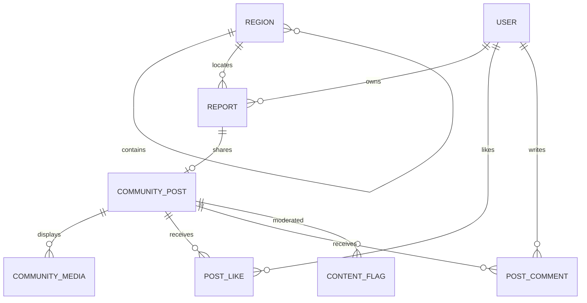

# WasteWise: komunitas, peta Indonesia, dan desain bersama

Status: **rencana untuk ditinjau, belum implementasi**. Tanggal: 2 November 2026.

Dokumen pendamping: [prompt aset](ASSET_PROMPTS.md), [matriks layar dan penerimaan](SCREEN_MATRIX.md).

## 1. Keputusan pengguna dan batas rencana

- Home menjadi feed foto laporan: like, komentar, lokasi dari GPS, deskripsi, kategori ML dan status penanganan.
- Feed hanya untuk pengguna yang login. Pengguna meminta lokasi sesuai GPS pada card serta filter kota, kecamatan hingga kelurahan. Peta web/mobile menampilkan titik lokasi dan mengikuti filter tersebut.
- Landing web mengikuti dua screenshot Bantuin: judul tulisan tangan, ilustrasi tinta, ruang lapang, navigasi berbingkai. Screenshot navbar menjadi acuan tombol kamera tengah yang lebih menonjol.
- Web/mobile memakai palet hijau dan tipografi bersama. Nama tetap WasteWise. Bahasa antarmuka Indonesia.
- Onboarding, error 4xx/5xx, logo simbol/teks dan prompt seluruh aset termasuk scope.
- Stack React/Vite, Expo, FastAPI, PostgreSQL/Supabase dan model 12 kelas dipertahankan. Training ulang bukan bagian perubahan sosial/desain.

**Interpretasi operasional:** laporan baru muncul ke sesama pengguna setelah pemilik menekan kirim dengan pilihan berbagi yang jelas. Foto yang baru dipilih tetap draft privat, sampai ML/GPS/deskripsi memenuhi kontrak. Di Home pemilik dapat melihat pintasan draft sendiri untuk melanjutkan. Draft tidak menerima like/komentar dan tidak menjadi titik komunitas.

**GPS terlihat oleh komunitas adalah perubahan privasi material.** Pratinjau berbagi harus menampilkan foto, caption, nama tampilan, alamat wilayah dan titik/koordinat yang akan dilihat sesama pengguna login. Pilihan `Bagikan ke komunitas` tidak dicentang diam-diam. Laporan lama tidak dipublikasikan melalui backfill otomatis. Pengguna bisa mengirim laporan privat dan membagikannya kemudian. Tidak ada perubahan data atau kebijakan publikasi selama tahap rencana.

## 2. Temuan repo yang menentukan pekerjaan

| Kondisi saat ini | Konsekuensi rencana |
| --- | --- |
| `web/src/App.tsx` menampilkan Login sebelum seluruh route bila tidak ada sesi; `/` adalah dashboard | Landing butuh layout/route publik terpisah dari shell aplikasi dan admin |
| `mobile/app/(tabs)/index.tsx` menampilkan statistik; tab adalah Ringkasan/Laporan/Klasifikasi/Panduan/Profil | Home, Peta, tombol Foto dan perpindahan akses Panduan harus dirancang bersama |
| `Report` menyimpan foto, deskripsi, GPS, kategori, pemilik dan status; belum ada post, like, komentar atau wilayah administratif | Fitur sosial perlu migrasi dan API baru, bukan mengubah list laporan agar terbuka ke semua orang |
| `reports.py` dan `workflow.py` membatasi data menurut pemilik/admin | Kontrak laporan privat dipertahankan; komunitas memakai DTO dan otorisasi khusus |
| Cleanup/reconcile baru mengenali referensi Report/ReportDraft dan pola `owner/uuid.jpg` | Media komunitas wajib dilindungi dan dibersihkan oleh lifecycle yang diperluas |
| Foto sudah melalui draft/inferensi/GPS otomatis | Jalur kamera/ML yang berfungsi tidak diganti dengan input kategori/lokasi manual |
| Web memakai Plus Jakarta Sans; mobile belum memuat font brand bersama | Ganti font melalui satu sistem token dan pemetaan web/native |
| Source Bantuin memakai Caveat400/700 dan Manrope400/500/600/700 | Pasangan font referensi dapat digunakan secara tepat; tidak perlu menebak dari screenshot |
| Error web berupa fallback umum, mobile belum memiliki sistem layar error bersama | Error perlu komponen/status mapping serta fallback tanpa aset |

Bukti diperiksa pada `backend-ml/app/models.py`, `reports.py`, `workflow.py`, `cleanup.py`, `reconcile.py`; `web/src/App.tsx`, `main.tsx`, `ui.tsx`; `mobile/app/_layout.tsx`, `(tabs)/_layout.tsx`, `(tabs)/index.tsx`, `mobile/src/ui.tsx`. Font referensi: `/Users/rakan/Documents/bantuin/src/app/layout.tsx`, `globals.css`, `brand-theme.css`, dan `DESIGN.md`. Tidak mengasumsikan source lokal membuktikan deployment terbaru Bantuin.

`PRODUCT.md`, `DESIGN.md` dan `.superdesign/design-system.md` masih mencatat brief operasional lama. Permintaan baru menambah permukaan marketing/komunitas; revisinya dilakukan bersama implementasi. Salinan `.superdesign` mempunyai informasi lama tentang input manual dan jumlah tab; jangan menjadikannya kontrak perilaku.

## 3. Prioritas dan risiko

| Prioritas | Risiko | Keputusan penanganan |
| --- | --- | --- |
| P0 | GPS, foto rumah, nama atau caption mengungkap identitas/tempat pribadi | Audience login, pratinjau berbagi, pilihan eksplisit, cabut publikasi, pelaporan konten; tidak membuka laporan lama |
| P0 | DTO komunitas membocorkan email, image_path, event internal atau data laporan privat | DTO allowlist; akses direct report tetap owner/admin; tes negatif lintas akun |
| P0 | Foto yang masih dipakai feed terhapus worker/reconcile | Referensi CommunityMedia ikut pemeriksaan cleanup; transaksi/outbox dan tes penghapusan lengkap |
| P0 | Like/komentar menjadi jalur spam, XSS atau manipulasi jumlah | Teks biasa, batas panjang/rate, unique like, idempotensi, moderasi admin dan audit |
| P1 | Label kota/kelurahan keliru atau geocoder menghambat kategori | Resolver wilayah server terpisah dari inferensi, sumber/version tercatat, state belum terpetakan |
| P1 | Peta memuat semua foto/pin Indonesia dan membuat HP berat | Bbox/zoom, cluster server, batas hasil, thumbnail, lazy map dan pembatalan request |
| P1 | Route baru merusak reset password, sesi atau deep link | Pertahankan callback Supabase, alias route lama, uji login/recovery/reload |
| P1 | Desain menghilangkan keterbacaan status/tabel | Caveat untuk display; Manrope untuk isi/data; kontras dan target sentuh terukur |
| P2 | Ilustrasi, font dan animasi menambah unduhan | Anggaran aset, font lokal terpilih, reduced motion; kamera/feed tanpa dekorasi besar |

Foto yang sudah diunduh atau signed URL yang belum kedaluwarsa tidak bisa dijamin hilang seketika. Metadata EXIF dihapus; itu tidak otomatis menghapus wajah, plat nomor atau alamat yang terlihat di piksel/caption. Crop dan pemeriksaan sebelum berbagi tersedia; deteksi/blur wajah otomatis tidak diklaim tersedia tanpa implementasi dan pengujian terpisah.

## 4. Alur produk

### 4.1 Foto sampai Home

1. Tekan tombol **Foto** tengah; buka kamera. Pilihan galeri tetap tersedia.
2. Foto diproses oleh jalur ML sekarang; kategori dan confidence muncul otomatis. GPS kamera/EXIF/konfirmasi unggah mengikuti aturan yang sudah disepakati.
3. Isi deskripsi kondisi. Tidak ada pemilihan kategori atau pengisian koordinat manual oleh user.
4. Tampilkan pratinjau berbagi: audience, foto, caption komunitas, nama tampilan dan titik GPS. Caption awal dapat disalin dari deskripsi untuk ditinjau; perubahan laporan privat berikutnya tidak otomatis mengubah caption publikasi.
5. `Kirim laporan` menyimpan laporan; bila berbagi dipilih, transaksi juga membuat post berstatus `processing` dan job media/wilayah. Jangan menunggu penyedia peta untuk mengembalikan hasil ML.
6. Home pemilik menampilkan status pemrosesan. Sesama pengguna baru melihat post setelah media aman tersedia. Jika label wilayah belum selesai, tulis `Wilayah sedang dikenali`; filter wilayah tidak memasukkan post tersebut ke daerah tebakan.
7. Card final menampilkan nama tampilan, waktu, foto, kategori, status, deskripsi, kelurahan/desa–kecamatan–kabupaten/kota–provinsi, akses koordinat GPS, sumber/akurasi bila tersedia, like dan komentar. `Lihat di peta` menyorot titik GPS post yang sama.
8. Jika pemrosesan gagal, laporan privat tetap tersimpan. Pemilik dapat retry tanpa menggandakan laporan/post/inferensi.

Kategori ML berlabel sebagai perkiraan. `needs_review` klasifikasi dan moderasi konten adalah dua state berbeda. Like tidak mengubah urgensi, kategori, status penanganan atau kualitas model. `Completed` tetap keputusan admin tentang laporan.

### 4.2 Like dan komentar

- Satu like per akun/post; PUT untuk like, DELETE untuk unlike. Klik cepat ditahan selama mutasi; UI optimistis pulih bila gagal.
- Komentar berupa teks biasa 1–1000 karakter, Unicode dinormalisasi; tanpa HTML, file, mention dan tautan aktif otomatis pada rilis awal.
- Daftar komentar memakai cursor; input tetap aman saat keyboard terbuka. Retry POST memakai request UUID/idempotency key yang sama.
- Penulis dapat menghapus komentarnya. Pemilik post tidak memperoleh kewenangan menghapus komentar orang lain; dapat melaporkan komentar. Admin dapat menyembunyikan konten dengan alasan dan audit.
- Post hidden/removed tidak dapat di-like, dikomentari atau ditemukan melalui endpoint peta/ID. Semua jalur mengulangi pemeriksaan visibility di server.
- Jumlah like/komentar berasal dari query agregat yang konsisten. Optimistic UI tidak dianggap data permanen.
- Tidak membuat antrean posting offline diam-diam. Saat jaringan gagal, pertahankan teks dan tampilkan retry yang idempoten.

### 4.3 Moderasi minimum

Menu card/komentar: laporkan konten, batalkan publikasi untuk pemilik, lihat detail. Admin mempunyai antrean laporan komunitas, hide/restore dengan alasan dan event. Tindakan moderasi publikasi tidak otomatis mengubah status operasional laporan sampah. Penghapusan akun/laporan harus menghapus atau menonaktifkan post, interaksi dan media turunannya menurut kebijakan retensi yang didokumentasikan. Audit sensitif hanya untuk admin.

## 5. Indonesia: wilayah dan peta

### 5.1 Hierarki dan data

- Filter: Indonesia → provinsi → **kabupaten/kota** → kecamatan → **kelurahan/desa**. Label desa diperlukan untuk wilayah yang bukan kelurahan.
- Kota bisa dicari langsung; hasil menampilkan kabupaten/kota dan provinsi agar nama serupa tidak tertukar. Pilihan turunan di-reset bila induk berubah.
- Gunakan kode wilayah dan geometri administratif dari sumber resmi yang terverifikasi: Kemendagri untuk kode administrasi, BIG/BPS untuk batas bila lisensi/penggunaannya mengizinkan. Kode BPS dan Kemendagri tidak dianggap identik; pilih satu identitas internal dan mapping eksplisit bila sumber berbeda.
- **Gate data:** sebelum impor, catat URL unduhan, tanggal/version, lisensi/atribusi, checksum, kelengkapan hingga desa/kelurahan, validitas geometri dan kecocokan kode. Belum ada dataset wilayah yang diverifikasi dalam tahap ini. Jangan mengaku seluruh Indonesia sudah terpetakan.
- Snapshot wilayah disimpan di server; dropdown tidak bergantung pada API wilayah gratis pihak ketiga saat setiap layar dibuka.
- Resolver memakai point-in-polygon PostGIS dengan indeks spasial; cek dukungan ekstensi Supabase pada fase awal. Jika ekstensi tidak tersedia, gunakan worker geometri lokal dengan lookup terindeks, kontrak API tetap sama.
- GPS mentah/provenance tetap asli. Nama administratif diturunkan server; memilih filter tidak mengubah lokasi laporan. Jangan mengganti pin dengan centroid kelurahan atau lokasi IP.
- Simpan `region_resolution_state`, sumber/version, waktu resolver dan pesan kegagalan yang aman. Pinggir batas, kawasan perairan, wilayah tidak ditemukan, luar Indonesia dan data kelurahan tidak lengkap punya state eksplisit. Jangan memaksakan kelurahan terdekat sebagai hasil pasti.

### 5.2 Peta di web/mobile

- Peta merupakan tujuan navigasi utama. Filter region, kategori dan status memakai objek filter yang sama dengan feed.
- Web: MapLibre GL JS dimuat hanya pada halaman Peta. Native: `react-native-maps`, diverifikasi terhadap Expo SDK58 dan Expo Go terpasang sebelum dipasang. Jika butuh development build, jelaskan sebelum mengganti jalur pengujian pengguna.
- Native default Apple Maps pada iOS, penyedia Android yang didukung paket. Production Android membutuhkan konfigurasi key peta dengan pembatasan aplikasi yang sesuai. Web membutuhkan penyedia style/tiles beratribusi dan kuota yang diketahui. Provider, batas gratis dan biaya perlu diverifikasi pada fase0; jangan mengandalkan server tile publik OSM sebagai layanan produksi tanpa batas.
- Hasil API sesuai bbox dan zoom; cluster pada tampilan luas, pin ketika diperbesar. Jangan mengirim seluruh koordinat nasional sekaligus. Batas awal maksimal500 feature/response; respons menginformasikan clustering/truncation.
- Query server PostGIS/GiST, filter region/kategori/status, dan visibility identik dengan feed. Bbox/zoom tervalidasi. Query bbox memiliki batas area/zoom/biaya untuk menghindari scan tak terbatas.
- Tap cluster memperbesar; tap pin membuka ringkasan/bottom sheet: foto kecil, kategori, status, lokasi, deskripsi singkat, akses detail post. GPS ±akurasi divisualisasikan bila tersedia, bukan dianggap lokasi presisi absolut.
- Warna pin selalu dipasangkan bentuk/ikon/teks dan legenda. Cluster count tidak boleh menghitung laporan privat/hidden.
- `Lokasi saya` meminta izin hanya setelah ditekan. Menolak izin tidak menghalangi pencarian/filter Indonesia. Tidak ada tracking latar belakang.
- Kamera dan galeri menyimpan sumber GPS yang sama seperti sekarang. Foto galeri tanpa EXIF tetap memerlukan pernyataan foto berasal dari lokasi unggah.
- Maps down/offline: shell, filter dan daftar hasil masih dapat dibuka bila data ada; tampilkan error peta lokal. Jangan menjadikan seluruh Home gagal karena tile gagal.
- `Sekitar saya`/radius merupakan pengembangan setelah filter administratif dan bbox stabil; tidak diperlukan untuk memenuhi filter kota–kelurahan.

## 6. Struktur data dan kontrak API yang diusulkan

### 6.1 Model tambahan

| Model | Data/constraint utama |
| --- | --- |
| `CommunityPost` | UUID, report_id UNIQUE/FK, author_id/FK, caption, publication_status, shared_at, privacy_notice_version, revision, public_location fields berdasarkan GPS laporan, published_at/updated_at |
| `CommunityMedia` | post_id/FK, object_path UNIQUE, width/height, MIME, checksum, generation/status; hanya turunan yang disiapkan untuk berbagi |
| `PostLike` | PK/UNIQUE(post_id,user_id), created_at; cascade saat post dihapus |
| `PostComment` | UUID, post_id/user_id FK, body, state visible/hidden/deleted, request_id scoped akun, timestamps/revision |
| `ContentFlag` | actor/post/comment target, reason, state, admin resolution/audit; batas spam/deduplikasi |
| `Region` | internal ID, parent_id/FK, level, official_code/source/version, nama, active/validity, geometri terverifikasi |
| `BackgroundJob` | job_type, subject_id, attempt/lease/next_attempt, deduplication key; media dan resolver dapat diulang |
| Profil tambahan | display_name komunitas yang ditinjau pengguna; tidak mempublikasikan email atau seluruh profil Auth |
| `Report` tambahan | region_id nullable, region_resolution_state/source/version; koordinat/provenance lama dipertahankan |

`public_location` di sini berarti lokasi pada permukaan komunitas login, bukan akses internet anonim. DTO post mengizinkan GPS sesuai keputusan pengguna, tetapi tidak menyertakan email, password/Auth metadata, private image_path, riwayat admin, payload geocoder mentah atau ID laporan privat yang tidak dibutuhkan pembaca.

Feed memakai urutan kronologis `(published_at DESC, id DESC)` dan cursor opaque tervalidasi. Tidak ada algoritma rekomendasi awal. Indeks publication state/created/id, region hierarchy, kategori/status dan spatial point mengikuti query EXPLAIN; jumlah like/komentar memakai agregat batch dan liked_by_me, bukan satu query per card. Tidak menambah counter denormalisasi sebelum beban membenarkannya.

### 6.2 Endpoint rancangan

Semua endpoint di bawah prefix `/api/v1`, memakai envelope yang sama. Feed, post, komentar, like dan peta wajib login; role tetap diverifikasi per request.

| Method/path | Fungsi |
| --- | --- |
| `GET /community/feed` | Cursor, region_id, category, status; hasil post yang boleh dilihat |
| `GET /community/posts/{id}` | Detail post, lokasi dan interaksi; bukan detail laporan privat |
| `POST /community/posts` | Pemilik membagikan laporan yang sudah ada, idempoten; tidak membuka laporan lama secara massal |
| `PATCH /community/posts/{id}` | Pemilik mengubah caption/publikasi dengan revision |
| `DELETE /community/posts/{id}` | Batalkan publikasi idempoten; laporan operasional tetap privat |
| `PUT/DELETE /community/posts/{id}/like` | Like/unlike idempoten berdasarkan akun sesi |
| `GET/POST /community/posts/{id}/comments` | List cursor, tambah komentar dengan idempotency key |
| `DELETE /community/comments/{id}` | Hapus komentar milik sendiri atau admin sesuai kebijakan |
| `POST /community/flags` | Laporkan konten yang dapat dilihat pemanggil |
| `GET /community/map` | bbox/zoom + filter yang sama; cluster/point ringan |
| `GET /regions` | Search/parent/level, hanya data region tervalidasi |
| `GET /admin/community/flags` | Antrean moderasi admin |
| `PATCH /admin/community/posts/{id}` | Hide/restore dengan alasan dan revision |
| `PATCH /admin/community/comments/{id}` | Moderasi komentar dengan audit |

`POST /reports` mendapat opsi `share_to_community` dan caption yang divalidasi; default server tetap false bila client lama tidak mengirim. Lokasi/prediksi/pemilik tetap tidak diterima sebagai klaim bebas dari client. Transaksi create-report/post/outbox idempoten. DTO/admin OpenAPI dan shared contracts diperbarui bersama kedua client.

### 6.3 Media, keamanan dan lifecycle

- Bucket tetap privat. Feed memakai turunan JPEG terkompresi hingga1080px dengan pola key yang kompatibel `owner/uuid.jpg`; thumbnail kecil untuk peta/daftar. Signed URL pendek, misalnya5menit, dibuat hanya setelah cek akses.
- Original laporan tidak dibuka ke sesama pengguna. Uji signed URL kedaluwarsa dan refresh batch tanpa loop request.
- Worker media/resolver baru tidak menjadi langkah blocking pada unggah/inferensi yang sudah dioptimasi. Status job dan retry terlihat pemilik; monitoring mengungkap job macet.
- Cleanup/reconcile harus memeriksa referensi media post, melindungi objek aktif, dan mengantrekan media post saat unshare/delete/account-delete. Saat hide karena moderasi, kebijakan retensi media diputuskan eksplisit; URL baru tidak diterbitkan.
- Foto/status/region report yang berubah memperbarui proyeksi post secara terkendali. Penggantian foto menonaktifkan media lama, menjalankan sanitasi baru, menjaga like/komentar dengan penanda telah diedit. Jika sumber lokasi/foto berubah, pemilik meninjau ulang publikasi sebelum media baru dibagikan.
- Auth provider tidak diganti; komunitas tidak boleh memakai service key di client. Cache query dipisahkan menurut akun, filter dan audience; logout membersihkan data komunitas yang sensitif.
- API/rate limit bersifat server-side. Batasi list, body, komentar, flags, likes dan bbox. Konfigurasi multi-worker perlu limiter bersama sebelum produksi.
- Default implementasi memakai backend FastAPI yang ada; jangan menambah pembacaan tabel `app_private` langsung dari client atau kebijakan RLS publik untuk mempercepat feed.

## 7. Arsitektur halaman dan navigasi

### Web

- `/`: landing publik, ringan, dapat dibuka tanpa API/Auth siap. User yang sudah login mendapat tombol `Buka beranda`.
- `/auth/login`, `/auth/register`: autentikasi dalam layout publik; `/auth/reset-password` dan alur PKCE yang sudah ada dipertahankan.
- `/onboarding`: pengenalan opsional; setelah login melanjutkan tujuan awal yang aman.
- `/app/feed`, `/app/map`, `/app/posts/:id`, `/app/reports`, `/app/reports/:id`, `/app/new-report`, `/app/guide`, `/app/profile`: shell pengguna.
- `/admin`: dashboard operasional; `/admin/reports`, `/admin/users`, `/admin/community`: admin. Admin juga dapat membuka komunitas dengan navigasi eksplisit.
- Route lama `/reports`, `/reports/:id`, `/classify`, `/guide`, `/users` diberi redirect terautentikasi ke tujuan baru yang benar. Redirect tidak boleh melewati guard peran atau membuka URL luar.
- Guest yang membuka post/peta diarahkan login dengan returnTo internal; setelah login kembali ke tujuan. Post terhapus/privat/hidden memakai state404 generik tanpa membocorkan isinya.

### Mobile

Lima posisi bawah: **Beranda — Peta — Foto — Laporan — Profil**.

- Foto merupakan action tengah, bukan halaman kosong yang berpura-pura tab. Tekan membuka camera modal; batal kembali ke tab sebelumnya. Galeri tersedia di kamera/composer.
- Diameter visual64–68px, ikon kamera/scan30–32px, target seluruh tombol, label `Foto` terlihat. Lingkaran putih luar, hijau utama, elevasi lembut; menonjol sekitar12–16px dari bar tanpa menutupi isi.
- Safe-area/home indicator, hitSlop, fokus, VoiceOver/TalkBack, urutan tab dan keyboard diuji. Tab lain target minimal44px, Android48dp; jumlah tetap5.
- Konten mendapat padding bawah sesuai tinggi bar/tombol. Saat keyboard komentar terbuka, input dan kirim tetap terlihat.
- Panduan dipindah ke Profil dan tautan tindakan hasil ML; fungsi tetap dapat dicapai. Route lama Klasifikasi tetap membuka composer kompatibel dengan deep link.
- Peta tidak mengambil GPS pada setiap perpindahan tab. Home memakai FlatList/virtualized list, bukan ScrollView semua post.

## 8. Desain dan warna

### 8.1 Arah visual

Landing: hijau terang seperti kertas, Caveat besar, ilustrasi tinta bertema lingkungan Indonesia, blok editorial yang lega; mengambil ritme referensi dengan identitas WasteWise sendiri. Tekstur hanya aset kecil sangat halus bila membantu, tidak menurunkan kontras.

Aplikasi: foto pengguna sebagai pusat; card bersih, metadata singkat, status jelas, whitespace terukur. Form, tabel, peta dan panel admin memakai komposisi tugas. Ilustrasi ditempatkan pada pengenalan/empty/error; tidak disisipkan di setiap card atau data table.

### 8.2 Token usulan

| Token | Nilai | Pemakaian |
| --- | --- | --- |
| `canvas` | `#F5F7F4` | Halaman aplikasi |
| `landingCanvas` | `#F0F7EF` | Landing/onboarding |
| `surface` | `#FFFFFF` | Card/form/navbar |
| `primary` | `#215B3C` | CTA, kamera, link utama |
| `primaryHover` | `#17492F` | Interaksi |
| `ink` | `#17281F` | Teks utama |
| `muted` | `#56665C` | Keterangan yang tetap terbaca |
| `sage` | `#E4EFE5` | Selection/ilustrasi panel |
| `marker` | `#D8EB96` | Sorotan singkat dengan teks gelap |
| `border` | `#DCE4DC` | Pemisah dekoratif |
| `inputBorder` | `#7A907E` | Batas input/fokus yang perlu kontras komponen |
| `danger` | `#A52D36` | Error/aksi berisiko |
| `warningInk` | `#825006` | Pending/peringatan pada latar pucat |
| `infoInk` | `#225A87` | In Progress pada latar biru pucat |

Satu sumber `shared/design-tokens.json` menghasilkan CSS custom properties dan pemetaan React Native. Hitungan kontras sRGB pada tahap rencana: ink/canvas14,34:1, muted/putih6,09:1, putih/primary8,00:1, ink/marker11,95:1 dan inputBorder/putih3,43:1. Ini memvalidasi pasangan warna dasar, bukan seluruh layar/focus/disabled state. Hijau tidak menggantikan seluruh warna status. Jangan memakai marker sebagai teks di atas putih.

Tipografi tepat referensi: **Caveat400/700 + Manrope400/500/600/700**, self-hosted dengan OFL/atribusi diperiksa. Web WOFF2; native TTF/OTF yang didukung Expo Font. Caveat hanya judul hero, onboarding, heading empty/error; isi, feed caption, angka, kontrol, tabel, label peta dan confidence memakai Manrope. Body16px/sp, line-height1,5–1,65; metadata tidak di bawah12. Skala display responsif; tidak memotong nama wilayah atau membatasi pembesaran font sistem.

Desktop feed: navigasi kiri yang tenang, kolom foto utama sekitar600–680px, panel filter ringkas; jangan memenuhi layar dengan tiga kolom foto yang terlalu kecil. Tablet panel filter menjadi drawer. Ponsel satu kolom penuh dengan filter ringkas/sticky, tanpa menghalangi foto. Peta desktop dua panel daftar–peta, ponsel peta dengan bottom sheet terjangkau ibu jari.

Radius12/16/24 sesuai fungsi; satu sistem spacing4/8/12/16/24/32/48/64. Ikon satu keluarga per platform, stroke/bobot selaras. Animasi press100–160ms, drawer180–240ms; feed tidak mendapat entrance animation berulang. Reduced motion dihormati.

## 9. Landing web

1. Navbar berbingkai: logo simbol+WasteWise, Cara kerja, Komunitas, Peta, Panduan/FAQ, Masuk, CTA `Mulai memotret`. Komunitas/peta membutuhkan login; bukan halaman buntu.
2. Hero split: usulan copy **“Kenali sampahnya. Mulai dari sekitarmu.”** Caveat; penjelasan Manrope: foto dikenali model, lokasi tercatat, laporan dapat dibagikan dan dipantau. CTA primer mulai; sekunder lihat cara kerja.
3. Ilustrasi asli: kamera, satu objek sampah, petunjuk memilah dan pin lingkungan; palet hijau, bahasa visual tinta seperti referensi. Teks tetap HTML, bukan tulisan di bitmap.
4. Tiga langkah editorial: foto/galeri, kategori+GPS, kirim+pantau komunitas. Di ponsel urutan vertikal tetap logis.
5. Pratinjau feed/peta dengan data demo berlabel `Contoh tampilan`; jangan mengambil koordinat/foto privat pengguna untuk marketing. Preview bukan bukti laporan nyata.
6. Panduan12kategori menggunakan contoh beratribusi/ilustrasi edukasi. Klaim akurasi hanya metrik test dengan sumber dan batas, bukan “selalu akurat”.
7. Penjelasan privasi GPS/komunitas, FAQ, CTA penutup, footer bantuan/privasi/ketentuan.

Tidak memakai testimoni, mitra, volume sampah terselamatkan atau unduhan aplikasi yang belum ada. Tautan store hanya muncul setelah build/listing nyata tersedia. Halaman tetap berguna tanpa JavaScript untuk informasi inti melalui prerender/SSG Vite yang dipilih saat implementasi; jangan migrasi seluruh aplikasi ke framework lain demi landing.

## 10. Onboarding

Tiga layar opsional, satu konsep per layar:

1. **Foto satu objek sampah.** Kamera atau galeri. Aset OB01.
2. **Kenali kategorinya, pastikan lokasinya.** ML berupa perkiraan; GPS kamera/EXIF/konfirmasi unggah dijelaskan singkat. Aset OB02.
3. **Bagikan dengan sadar. Pantau bersama.** Komunitas login, titik GPS dan caption terlihat, pemilik dapat membatalkan publikasi. Aset OB03.

Indikator1/3, Berikutnya, Kembali, Lewati dan Mulai. Bisa dibuka ulang dari Profil. Versi onboarding disimpan tanpa token; jangan muncul setiap login. Persetujuan membagikan GPS tetap dilakukan pada setiap publikasi, bukan dianggap disetujui karena onboarding selesai. Izin kamera/GPS diminta saat fitur dipakai, bukan seluruhnya saat pertama aplikasi terbuka. Web guest boleh membaca pengenalan tanpa register dulu; returnTo/login/recovery tidak boleh tersangkut onboarding.

## 11. Error 4xx/5xx dan state non-HTTP

Gunakan `ErrorState` bersama: judul, alasan yang aman, tindakan relevan, aset lokal kecil, request ID opsional. **Tidak perlu membuat100halaman status.** Status yang berdampak sama memakai template bersama; fallback mencakup semua4xx/5xx yang belum dikenal. API tetap JSON dengan status HTTP benar, bukan redirect200 ke halaman error.

| Status | Penyajian dan pemulihan |
| --- | --- |
| 400,405,422 | Error dekat form/aksi; perbaiki input. Full-page hanya jika konteks halaman tidak tersedia |
| 401 | Simpan draft/input, refresh sesi sekali sesuai SDK; jika tetap gagal tawarkan masuk dengan returnTo |
| 403 | Layar akses dibatasi; kembali ke area yang diizinkan, tanpa menampilkan isi terlarang |
| 404,410 | Post/halaman tidak tersedia, link ke Beranda/Peta; resource tersembunyi tidak dibedakan untuk user lain |
| 408 | Waktu permintaan habis; retry aman, pertahankan input |
| 409 | Jelaskan versi berubah/draft sudah dipakai, muat data terbaru; jangan menimpa perubahan diam-diam |
| 413,415 | Pertahankan composer; ganti/kompres foto sesuai kontrak dan format yang didukung |
| 429 | Tampilkan jeda dari Retry-After bila tersedia; hentikan spam tombol |
| 500,501 | Gangguan aplikasi/fitur belum tersedia; ulangi aman atau kembali |
| 502,503,504 | Gangguan sementara/server/provider; retry dengan backoff, status pemeliharaan jika diketahui |
| 4xx/5xx lain | Fallback keluarga status yang aman; jangan menampilkan stack trace |
| Offline, DNS, tile peta, izin ditolak | State tersendiri tanpa mengarang kode HTTP; peta punya fallback daftar |
| Runtime error client | Error boundary mempertahankan shell bila mungkin; tidak diberi label HTTP500 palsu |

Aset error mengikuti8tema di ASSET_PROMPTS. Kegagalan load ilustrasi tidak boleh menghilangkan pesan/tombol. Bundel fallback teks dan ilustrasi inti bersama aplikasi agar tidak bergantung pada API yang sedang error. Respons500/502 dari hosting sebelum JS dimuat memerlukan halaman statis/fallback pada layer hosting; uji saat deployment, bukan dianggap selesai oleh komponen React. SPA catch-all dapat mengirim200 untuk URL tak dikenal walau layar menulis404; atur route/404 pada hosting atau prerender server bila status HTTP dokumen harus404. Jangan mengklaim komponen client mengubah status respons origin.

## 12. Performa dan aksesibilitas: target, bukan hasil

- Home memuat15post awal, cursor berikutnya; thumbnail peta kecil, feed1080pxJPEG dengan ukuran/aspect-ratio yang disimpan. Sasaran media feed80–180KB umum, bukan memaksa semua foto kompleks menjadi buruk.
- Hero desktop maksimal200KB; ilustrasi onboarding/error sekitar40–100KB; total font web awal ditargetkan≤160KB terkompresi. Unduh hanya gambar aktif/berikutnya pada onboarding.
- Peta dan library peta tidak masuk initial route landing/feed. Tidak ada autoplay video, Lottie besar atau ilustrasi3D per halaman.
- Like/komentar memberi feedback langsung dan rollback; ML tidak menunggu geocoding, media komunitas atau tiles.
- SQL EXPLAIN di fixture50.000post dan relasi like/comment, bukan data produksi; pantau N+1, p95 server dan payload cluster. Query resolver/media tidak bersaing tanpa batas dengan inferensi.
- Target web LCP<2,5detik, CLS<0,1, INP<200ms; target feedback tekan<100ms; target response feed/peta API p95≤1detik dalam deployment dekat Supabase. Harus diukur dan disesuaikan dari baseline; bukan janji latency internet pengguna.
- Ukur foto→kategori, foto→post siap dan hapus terpisah di iPhone/Android nyata; optimasi sebelumnya dipertahankan. Jangan memakai angka benchmark3sampel lokal sebagai p95.
- Kontras teks≥4,5:1, komponen/fokus≥3:1, focus ring, skip link, label layar pembaca, alt yang tidak mengarang objek foto. Peta selalu punya alternatif daftar/teks.
- Uji320/360/390/768/1024/1440px, zoom200%, font sistem besar, layar kecil, keyboard terbuka, reduced motion dan jaringan lambat.

## 13. Urutan implementasi dan gate

| Fase | Hasil konkret | Gate sebelum lanjut |
| --- | --- | --- |
| 0. Kontrak dan sumber | Finalisasi share/GPS, DTO feed/map, region source/license, penyedia tiles/keys, revisi brief visual | Data wilayah sampai kelurahan valid atau gap diumumkan; akses dan biaya provider diketahui |
| 1. Fondasi | Token/font bersama, komponen dasar, layout publik/app/admin, error dasar dan route aliases | Login/reset/deep link lama tetap berfungsi; landing bisa tanpa API |
| 2. Sosial vertikal | Migrasi post/media/like/comment/flag/job, publikasi/unshare, private projection, cleanup | Dua akun bisa melihat post bersama; laporan privat tidak bocor; rollback/idempotensi/cleanup lulus |
| 3. Indonesia | Import wilayah, resolver GPS async, filter provinsi→kelurahan, state unmapped | Nama/kode/parent valid, batas dan kegagalan tidak mengarang wilayah; ML tidak melambat |
| 4. Peta | Bbox/clusters, web/native map, filter bersama, pin→card→detail | Hanya post yang diizinkan, filter sama dengan feed, bounded payload dan fallback tile |
| 5. UI lengkap | Feed modern, admin moderasi, mobile navbar Foto besar, detail/comment/composer | Responsif/keyboard/font besar, status dan aksi terbaca; regresi kamera/draft tetap lulus |
| 6. Identitas/aset | Logo final vektor, ilustrasi, landing/onboarding/error, optimasi format | Aset cocok matriks, lisensi/asal dicatat, teks UI tidak baked-in bitmap |
| 7. Validasi dan rilis | API/ERD/README baru, tests/evidence, CI, staging, device smoke dan paket deliverable | Seluruh acceptance di SCREEN_MATRIX lulus; gap produksi/device dijelaskan sebelum klaim rilis |

Fase dapat berisi beberapa commit kecil. Jangan menerapkan migrasi membuka feed sebelum guard, DTO, worker dan kedua client siap. Gunakan feature flags server/client yang tervalidasi untuk cutover; default fitur sosial baru off sampai smoke selesai. Migrasi additive, backup/rehearsal, rollout bertahap, rollback aplikasi mematikan publikasi baru tanpa menghapus data. Rollback bukan DROP tabel atau menyembunyikan kehilangan data.

## 14. File pekerjaan saat implementasi

- Shared: `shared/contracts.ts`, `shared/request.ts`, baru `shared/design-tokens.json`, `shared/regions.ts`.
- Backend: model/schemas/responses, baru `community.py`, `regions.py`, `map_queries.py`, `community_jobs.py`; perubahan reports/workflow/storage/cleanup/reconcile; migrasi Alembic, OpenAPI dan tes.
- Web: App/routing/main/styles/Auth, layout terpisah; `Landing`, `CommunityFeed`, `CommunityPost`, `CommunityMap`, `Onboarding`, `ErrorPage`; card/comment/filter/map/error primitives; admin moderasi.
- Mobile: root/tab layout, Home baru, Peta, composer/preview, post detail/comment, onboarding/error, font loader, cache policy dan UI token. Preservasi perubahan pengguna pada `mobile/tsconfig.json`.
- Assets: sumber bersama `assets/wastewise/`, manifest build ke web/native, lisensi dan QA. Jangan memuat gambar marketing di bundle route admin.
- Dokumentasi: PRODUCT/DESIGN/DECISIONS, API/OpenAPI/ERD/README/SETUP/TESTING/DELIVERABLES dan evidence baru. Metrik model lama tetap diberi konteks dataset test.

## 15. Yang sengaja ditunda

Stories, video, follow/DM, ranking viral, leaderboard dampak, push notification, rekomendasi ML sosial, deteksi wajah/OOD baru, dan peta offline seluruh Indonesia. Semuanya memperbesar biaya moderasi, privasi atau aplikasi tanpa diperlukan oleh sembilan permintaan dan tambahan peta.

**Langkah pertama implementasi:** tetapkan kontrak publikasi/GPS dan paket wilayah sampai kelurahan, lalu bangun satu laporan bersama dari kamera sampai card Home dengan dua akun. Selesaikan keamanan dan lifecycle sebelum memperluas layar.
